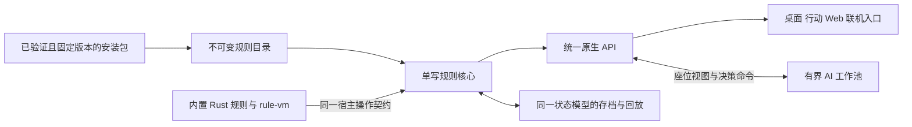

# 原生架构收敛执行方案

2026-10-18 用户已要求按架构审查方案落文档并交由后续 agent 完整执行。本方案确定目标、依赖与验收门槛；**写入方案不表示实现完成**。实施状态和待办只在[进度主稿](native-progress.md#native-convergence)更新，37 来源的逐项状态只在[扩展台账](../migration/upstream-extension-reconstruction.md)更新，规则语义和差异只在[规则基准](native-rules-baseline.md)更新。

采用方向是保留 Rust 单写规则核心、不可变目录、显式结算栈和可恢复选择，统一原生产品接口与扩展宿主，分离内容私有状态，建立可核验的产品与规则验收。目标平台和性能标准继续服从[性能架构](../../noname-performance-architecture.md)，扩展能力服从[宿主契约](native-extensions.md)。

[2026-10-18 审查证据](../operations/evidence/2026-10-18-architecture-audit/README.md)保存本方案的源码依据、测试和反例；这些结果只适用于该次记录的源码快照。后续执行者必须先复核当前源码，不能把历史缺陷当作仍未修复，也不能把历史全绿当作当前验收。[完整执行提示词](../operations/native-convergence-agent-prompt.md)可直接交给接手 agent。

## 1 范围与不可退让的边界

- 原生线最终承载项目已确定的上游内容范围及 noname、noname-liuli 两仓全部 37 个来源实例；G0–G5 顺序与每来源功能要求沿用台账，不另建来源清单。
- 玩家可独立安装、启停、升级、回退、卸载；作者可发布武将、技能、卡牌、模式、规则、AI、配置、资源和界面扩展。界面、声音、动画、跨局档案、平台服务和组合能力均不得通过缩小定义排除。
- 保留内置 Rust 规则与第三方 rule-vm 路线，沿用 [ADR 0782](../adr/0782-extension-backend-and-legacy-js-scope.md)。旧 JS 不要求零改动运行；不得因此取消独立扩展或真实功能。
- 复用 PackageStore、规则执行器、现有验证与证据体系。先在现有模块建立单向依赖，只有形成独立职责后才拆 crate；不为组织图预建空框架。
- 新增普通扩展内容应经公开 SDK、状态和规则接口完成，不能继续要求每个技能都扩张核心专用字段、全局行为枚举及手写编码分支。
- 任何规则、资源或平台能力尚未实现，必须显式报告不支持并保留待办；不能静默跳过、用空实现或占位表现算验收通过。
- 所有受维护源码、测试和 DSL 单文件不超过 2,000 行，按职责拆分，遵守[工作区规范](../../../AGENTS.md)。保留现有工作区修改、正式 ADR、上游快照和原始证据。

未由本方案采纳的[历史候选](architecture-evolution-plan.md)继续作为备选。全面 VM 化、统一 DSL 生成、特定过程宏、ECS、QuickJS、强化学习、特定 GPU 库和新传输协议都不是自动成立的实施要求。统一状态定义、原生产品闭环等能力是必做；具体机制由真实案例和测量决定。

## 2 目标架构



| 边界 | 必须承担的职责 | 禁止跨越的职责 |
|---|---|---|
| 安装与目录构建 | 验证实际安装字节、依赖、版本、能力、逻辑与资源指纹；构建本局固定目录 | 从原始导入目录重新取执行内容，或在局中静默换成最新版 |
| 规则核心 | 命令校验、单写事务、事件与选择、随机流、通用状态及恢复 | 依赖 DOM、文件系统、网络响应或具体 UI；让每个内容包直接扩张核心 |
| 内置规则与 rule-vm | 通过相同宿主语义查询、选择、提交效果和管理自身状态 | 绕过事务、信息边界与预算，或把错误当成功 |
| 原生 API | 权威命令结果、合法座位投影、可见事件、动作查询、选择 token、协议版本 | 由客户端推导规则合法性、填空事件或吞掉拒绝原因 |
| 表现和平台 | 渲染、输入、资源、音频、动画、配置 UI 与平台服务 | 直接写规则状态或向其他座位泄漏隐藏信息 |
| AI | 合法信息、受控模拟、候选、预算、取消、过期拒绝与策略评估 | 读取真实未知牌、阻塞规则主通道、使用与正式提交不同的规则 |
| 存档与回放 | 状态、续行、内容锁、编码版本及轨迹验证 | 依赖不可序列化闭包或默默替换缺失内容 |

规则配置进入逻辑内容锁；纯表现资源保留独立资源指纹。锁应来自实际载入产物，区分规则一致性与视觉重现所需内容。权威状态、座位视图和 AI 输入保持明确的类型及数据流边界。

## 3 完整工作包与验收条件

本节 NC01–NC12 是稳定的范围编号，便于 agent 分工与引用，不保存实施状态。各包的领取、依赖、结果和剩余项统一维护在[进度主稿](native-progress.md#native-convergence)。前一阶段的代表样本只验证接口，不能替代后续全来源验收。

<a id="nc01"></a>
### NC01 座位与触发语义

复核 `GameStateCore::seat_distance` 的整数环绕反例，修复根因；分别定义最短座位距离、顺座次序、存活座位环、换位和触发优先序，逐一迁移真实调用方。不能只让某几个数字通过而保留语义混用。

验收包括全部支持人数的座位对、旋转不变性、对称性、非同座距离非零、换位及死亡影响；逐调用方验证它应采用的语义。对触发次序、技能目标或费用造成的变化，核对上游与采用规则，登记版本及 golden 原因。审查探针只证明辅助方法算术与排序键，不替代完整技能场景。

<a id="nc02"></a>
### NC02 安装包身份与执行内容一致

原生载入统一经现有 PackageStore 解析已验证的安装副本，使用命名空间、包 ID、版本和内容指纹标识。原始 `extension_root` 可保留来源信息，不能作为执行内容的权威来源。卡牌、武将、宿主行为、VM 模块、初始化、配置及资源必须完整合并和交叉校验。

验收包括：删除或修改原始来源后仍加载原安装版本；同 ID 不同命名空间与多版本准确选择；混合卡牌与 VM 包不丢技能；安装内容损坏明确失败；重复载入稳定；安装失败保留旧版本；升级、禁用、卸载不改写已经固定内容锁的局。覆盖已有对局与存档所需版本的保留、重新取得和缺失拒绝。

<a id="nc03"></a>
### NC03 统一原生产品 API

复核并修复选项索引与值 token 混用、`kind` 选项类型遗漏、拒绝结果被丢弃、空事件与空 hash 占位、前端截取手牌拼接“合法动作”等路径。协议应明确 Accepted、Pending、Rejected、Fault、版本、修订号、选择身份及稳定 token；需要表示大整数时规定跨语言表示，避免隐式精度损失。

由内核提供权威动作查询或可验证的分步动作构建接口，UI 与 AI 不各写一套规则。Rust 与 TypeScript 共享或自动校验协议定义，序列化位于边界层。补齐当前产品需要的主动技、技能牌、回放与跳转等入口。

战斗页开局和恢复必须传递实际启用的包与锁；显示、存档记录、内核运行目录应对应同一载入结果。验收须穿过真实生产转接层及 Worker，包括选择往返、非法命令可见拒绝、多选/取消/过期选择、错误不污染状态、正式安装扩展开局及同锁恢复；不能只直接调用 WASM helper 或使用桩实现。

<a id="nc04"></a>
### NC04 VM 故障与事务语义

将执行错误和超额从 VM 传播到结算及命令结果，保留可定位的错误类型和来源。沿用已有预算与事务机制，定义失败段的状态、事件、随机流、待提交效果、续行、技能次数与标记如何回滚；不得以 `Flow::Done` 吞掉故障后继续当作正常规则执行。

验收覆盖正常完成、选择挂起后恢复、非法效果、fuel/内存/栈或既有执行限额、无效 token、恢复后故障与重复提交；验证外部结果和完整回滚。未支持的能力在载入或调用边界明确失败，不能通过略过语义完成验收。

<a id="nc05"></a>
### NC05 可独立发布的扩展宿主

保留内置 Rust 与第三方 rule-vm，共用查询、选择、效果、状态、生命周期、能力和故障契约。根据 37 来源需求补全主动、响应、触发、模式、AI、配置、资源和 UI 接入点，装载层保持解析、校验与装配职责，具体玩法和表现策略迁到对应功能边界。

先选三类真实纵向案例：重规则与嵌套选择；战役/跨局档案与升级恢复；皮肤、界面及跨插件组合。可从龙血/杀海、太虚/Boss、千幻/皮切/十周年等现有来源选择，最终范围在台账登记，不另设缩减后的替代需求。

样本经作者包产物→独立安装→启用→正式选将/开局→真实交互→存读档→升级/回退/卸载闭环。至少包含同包卡牌和新 VM 技能、持久私有状态及错误分支；无需重编译客户端、修改核心枚举或调用 `debug_grant` 才能运行。样本通过后仍须完成全部 37 来源。

<a id="nc06"></a>
### NC06 核心与内容私有状态分离

通用生命值、牌区、回合和结算结构留在核心；技能标记、寄存牌、限定次数、模式私有状态采用稳定命名空间、型别、作用域和大小限额。运行期可映射为紧凑 ID，不能退化为无校验的任意字符串字典。

逐职责迁移具体内容行为、扩展牌效果与技能专属状态，建立获得、失去、失效、回合结束、死亡及卸载的生命周期。只有有多处真实需求的通用能力才进入核心。名称驻留策略应覆盖重复载入与持续载入不同包，明确所有权、条目及字节预算，并验证可回收部分。

验收以实际新增独立技能/牌/模式的改动范围和行为为准：普通内容不再要求同时扩张核心状态、封闭牌种/宿主行为总表、hash 和编码器。迁移中保持公开接口、错误处理、内容绑定和所有恢复路径；按功能迁移后验证，不能用关键词清零或机械拆文件作为完成证明。

<a id="nc07"></a>
### NC07 状态定义与持久化同源

让字段类型、稳定 tag、编码顺序、引用规则和语义 hash 策略有一致权威定义，供快照、编码、解码、恢复与验证复用。明确哪些字段进入规则 hash，不能未经语义判断直接对所有序列化字节取 hash。选择最小的共享遍历或生成机制；不预设必须新增过程宏。

正式发布前定义支持的存档/录像版本范围、迁移与拒绝政策，并保留对应内容版本；不默认要求转换所有内部历史格式，也不允许发布后每加一个技能就无说明地使旧局失效。

验收覆盖字段/tag 漏登记、未知值、长度/资源上限、尾部载荷、坏引用、坏续行、内容错版；每类选择点的字节保存、跨进程恢复和续行轨迹一致。需要改规则或格式版本时先分析原因，再登记并重录相应 golden。

<a id="nc08"></a>
### NC08 规则对照与原生验收门禁

固定采用的上游版本、初始局面、随机输入与玩家选择，复用现有场景和对照工具，逐命令比较状态、事件、选择、随机流与续行。旧线与新线一致、golden 未变和测试全绿分别记录，不能单独推导上游等价。

重新核对因“确定性”而简化玩家交互的差异：选择顺序可作为命令记录并确定性回放。确实保留的玩法变体在规则基准登记理由和影响；其余补齐真实语义。

给新 `engine-native` 与 `engine-native-wasm` 增加真正的跨目标运行与恢复门禁；现有旧线 `engine-cli`/`engine-wasm` hash 检查仍按旧线解释。修复重复测试属性、固定目录数等过期守护，以及在测试中重新实现生产逻辑的假闭环。用已知反例或受控变异证明关键门禁能失败，避免只检查文件存在、JSON 可读或命令能返回。

验收分别覆盖单元/性质测试、内核集成、生产适配器、真实客户端、原生服务端、native/WASM、上游行为和异常输入；各层报告自身边界，不合并成一个“完成率”。

<a id="nc09"></a>
### NC09 原生客户端与联机产品闭环

本地、WASM Worker 和服务端使用同一原生会话契约，正式联机房间接入原生权威规则，完成命令、观察者投影、重连、存读档、录像和错误展示。迁移时区分旧 `/ws` 与原生 HTTP/产品入口，不能把其中一个入口可用外推为全产品已切换。

实现性能架构要求的原生桌面/行动表现路径，以及 Web 自身的能力和性能档位。用真实素材与扩展验证牌桌、选将/选择、配置、皮肤、音频、动画、界面部件和平台服务；鼠标、触摸、窄屏、中英文、边界值与可访问性纳入适用场景。Tauri/Web 外壳、渲染预算结构或无界面 helper 不代替原生渲染交付。

验收至少包括千幻/皮切/十周年等实际组合、资源装卸和长期运行释放、会话恢复、错误可见、跨座位信息隔离；按性能架构的 Windows/macOS/Linux、Android/iOS 与 Web 范围逐目标取证。缺设备、素材或凭据时记录真实未验收项，不能改成“平台无关所以通过”。

<a id="nc10"></a>
### NC10 AI 信息边界与有界排程

复用现有节点/时间/取消预算与修订号检查，共用权威动作查询和规则模拟核心，完善主动技、多选、多目标及模式候选。将逐调用创建线程并同步等待的原型收敛为产品宿主中的长驻有界工作队列，限制并发、内存和排队，支持取消、降级与过期结果拒绝。

策略仅接收所属座位合法信息；受控模拟与策略输入分界，真实暗牌不得泄漏。AI 计算不得阻塞规则主通道，最终提交仍走同一命令校验。

验收包括同信息集替换暗牌不改变不应受影响的输入/行为、取消与过期、并发压力、不同模式/座位/种子/预算的质量及尾延迟。先建立基线再决定更强搜索，不能用少数种子胜率、单座位成绩或旧 `engine-ai` 成绩证明新 AI 已全面达标。

<a id="nc11"></a>
### NC11 验收数据与文档收敛

保留既定主稿分工，进度页只保留最新快照、失败项和待办；批次经过与原始输出归入有日期的流水/证据。规则基准区分当前语义与历史版本记录。README/架构索引只导航，不再复制当前数字。

复用现有来源登记工作，升级其证据模型：来源功能/配置入口→上游证据→生产接口→测试案例→源码/规则/平台版本→结果→未覆盖项。应与台账绑定并生成其展示/计数，不能并建第二套人工维护的状态表。仅匹配“八项整包”字符串、目录或测试文件存在，不能自动判整包完成。

逐项纠正现有完成声明，保留历史证据；真实范围缺失时撤回过宽结论，但不得未经逐项核查编造新的整包数量。解决 ADR 重复编号和标题错号时维护唯一标识、索引与旧引用，不批量删除不同决策；阻止新增冲突。

验收包括主稿间当前版本和状态一致、本地链接及必要锚点有效、证据与源码匹配、机器消费者兼容；缺少必需功能或平台结果时，整包汇总必须保持未完成。27 组重复编号等历史数字只作为审查快照，执行时重新计算。

<a id="nc12"></a>
### NC12 效能验收与旧线退出

从第一阶段起保存同设备、同工具链、同负载的基线，区分无扩展、单扩展和常用组合；量测启动、规则结算尾延迟、状态复制/模拟、存读档、AI、动画帧、输入响应与长局内存。优化前后记录配置、样本及失败；不同设备或负载不得计算收益百分比。

全部 37 来源和目标产品达到 G0–G5 对应门槛后，完成原生路径切换与旧产品执行线退出。逐项确认调用方、导出、资源、构建、测试、文档和机器消费者，再删除已被替代的胶水与旧运行入口；保留仍需的迁移工具、历史 ADR、原始证据和上游来源。

最终验收必须同时满足：原生入口使用真实包与规则；新 SDK 可独立发布；37 来源所有必需功能和组合已验收；目标平台与性能达标；无未解释的规则差异/失败；旧执行路径退出不会删除唯一功能或恢复能力。仅 Rust 全绿或代码能编译不能关闭本工作包。

## 4 六阶段顺序

| 阶段 | 工作包与依赖 | 退出条件 |
|---|---|---|
| 1 正确性与可信基线 | NC01–NC04；同步开始 NC11，保存 NC12 基线 | 已确认反例回归通过；类型检查及影响面的完整检查通过；失败与未验收项目登记准确 |
| 2 真实扩展纵向闭环 | NC03、NC05，依赖 NC02/NC04；有需要时实施 NC06/NC07 的最小完整切片 | 三类真实案例经正式安装和产品入口完成全生命周期，含混合包、选择与恢复 |
| 3 状态与规则结构收敛 | NC06–NC08，逐职责迁移 | 普通内容不再扩张核心专用字段与编码分支；恢复、规则与跨目标对照成立 |
| 4 产品与 AI | NC09、NC10；NC12 持续测量 | 原生本地/联机/目标平台与 UI 扩展真实可用，AI 排程及信息边界验收 |
| 5 全来源全矩阵 | NC05、NC08、NC09、NC11、NC12；沿用台账 G0–G5 | 37 来源逐项满足功能、配置、依赖、组合、恢复、平台、规则和性能条件 |
| 6 切换与退出 | NC12，依赖第 5 阶段 | 原生产品替代已验收，旧入口安全退出，导航、构建和证据同步 |

阶段不是日历工期。同阶段独立职责可并行；接口稳定后的渲染、资源和 AI 工作可提前并行，但不得跳过依赖或提前宣布后续阶段完成。代表样本不是第 5 阶段的范围上限。

## 5 执行与证据要求

每个工作包开工先读取最新主稿、来源台账、相关源码和测试，记录 HEAD、已有修改及内容指纹。结构问题优先 CodeGraph；工具不可用时按已定位文件读取。保留其他任务的改动，分配互不冲突的文件职责，写公共文档前重读；协调共享构建目录，禁止对共享 `target/` 执行 `cargo clean`。

实施顺序是反例/需求→共享根因→调用方与产物同步→对应回归→完整影响面检查→证据与主稿回填。已有正确实现复用并验证，不重复搭建。每批可独立回退；后续目标仍需持续推进，不能把一批通过当作整体完成。

基础验证命令在仓库根目录执行，平台、上游和产品验收按影响面另加：

```bash
python3 -B -m unittest discover -s scripts -p 'test_check_source_lines.py'
python3 -B scripts/check-source-lines.py
cargo test --offline -p engine-native --no-fail-fast
cargo test --offline -p content-native-loader -p content-runtime -p engine-native-wasm --no-fail-fast
cargo test --offline --workspace --no-fail-fast
pnpm --dir apps/web-client typecheck
pnpm --dir apps/web-client smoke:native
```

原生改动同时执行现有 Gate 1b；需不同 `RUSTFLAGS` 时使用受控独立构建目录。WASM 验收先按当前构建配置从本次源码重建，再执行真实目标；旧编译产物的冒烟只证明该产物。环境失败与断言失败分别保存，使用现有可用工具链重跑时记录工具链，不能覆盖首次失败记录。

每次更新记录核验日期、源码/规则/格式版本、工具链/设备、命令、完整通过/失败/忽略结果、证据链接和剩余边界。区分代码实现、反例修复、回归加入、定向通过、全量通过、产品/平台通过及上游等价。

外部设备、资源或权限暂缺时，留下可重跑命令、前置条件和确切未验收项，继续完成独立工作；只有所有门槛有证据时才宣称全部完成。最终报告按 NC01–NC12、六阶段及 37 来源逐一交代结果，不能以时间、上下文耗尽、测试数量或文档已写完替代完成条件。
