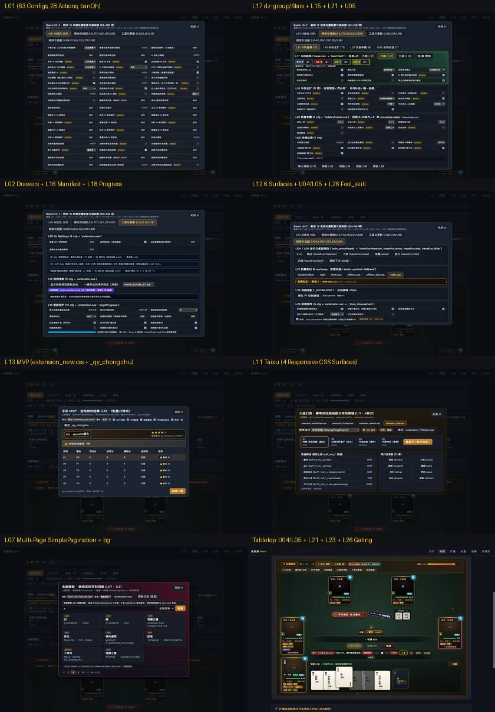

# Batch UI-7: 剩余 16 来源（171 项 configs / surfaces / ui_hooks）收口验证证据（Round 2）

- 验证日期：2026-11-21
- 工作区与分支：`/Users/ruyimg/Documents/Claude/sanguosha/.wt-conv-ui` (`swarm/conv-ui`, 基于 `5eb822daa` / `swarm/conv-ui-6`)
- 范围：覆盖 `docs/migration/g0/inventory_status.json` 中除前期批次外全部剩余 **16 个来源共 171 项**（`131 configs + 35 surfaces + 5 ui_hooks`），严格遵守裁决 34/35/38 净室边界（无商用二进制 Spine/美术/语音资产、无 `eval`/`Function`、无 Spine 运行库源码读取、无 Node 专属导入）。

## 1. 16 来源覆盖与诚实分层（纯 UI vs `ruleCoupled`）

| 来源 | configs (纯UI / ruleCoupled) | surfaces | ui_hooks | 关键实现模块与前端组件 |
| --- | --- | --- | --- | --- |
| `L01` AI优化 | 63 (`36` / `27`) | 0 | 0 | `aiOptimizeConfigSchema.ts`, `aiOptimizeSurface.ts`, `Batch7WorkbenchModal.vue`, `BattleBoard.vue`, `GeneralSelectPanel.vue` (`L01` 全 63 项 + `kzjs` 与全部 28 项动作键穷举无崩溃、`banQh` 实连选将刷将锁定、`viewAtt` 实桌态度抽屉、正数威胁度 JSON 校验，`eval` 已替换为结构化 JSON) |
| `L02` SJ Settings | 4 (`4` / `0`) | 1 (`extension.css`) | 0 | `toolsAndPoolSchema.ts`, `toolsAndPoolSurface.ts`, `Batch7WorkbenchModal.vue` (`consoleLogsOpen`、`tutorialDocOpen` 与 `offlineCatalogOpen` 三抽屉真实渲染，`batch7Surfaces.css`) |
| `L05` / `U04` coin | 0 | 4 (`haveFun.{firework,snow,star,blink}`) | 1 (`coin_arenaReady`) | `visualEffectsBatch7Runtime.ts` (`dispatchHaveFunEffect`, `dispatchCoinArenaReady`), `BattleBoard.vue` (`coin-fun-canvas`) |
| `L07` 全能搜索 | 4 (`4` / `0`) | 9 (`SimplePagination`, 6 高亮主题, `extension.css`, `extension_old.css`) | 0 | `visualEffectsBatch7Runtime.ts` (`buildSimplePaginationView`), `OmnisearchModal.vue` (6 套 `[data-l07-bg]` 主题背景样式 + 多页分页切换), `batch7Surfaces.css` |
| `L11` 太虚幻境 | 0 | 4 (`extension_{MobileStyle,PcStyle,servant,style}.css`) | 0 | `TaixuCampaignModal.vue` (`[data-l11-surface]`), `batch7Surfaces.css` |
| `L12` 如真似幻 | 0 | 6 (`dynamicSkin`, `rzsh`, `font.css`, `offline.css`, `offline_old.css`, `rzsh.css`) | 0 | `visualEffectsBatch7Runtime.ts` (`createInitialL12RzshState`, `static-portrait-fallback`), 6 套差异化 `[data-l12-surface]` CSS, `UiSkinSuitePanel.vue`, `Batch7WorkbenchModal.vue` |
| `L13` 手杀MVP | 7 (`7` / `0`) | 2 (`extension.css`, `extension_new.css`) | 1 (`_qy_chongzhu`) | `visualEffectsBatch7Runtime.ts` (`triggerQyChongzhuHook`), `MvpSettlementModal.vue` (`[data-l13-surface]`, `oneMore`) |
| `L15` 手杀全扩 | 11 (`3` / `8`) | 0 | 0 | `toolsAndPoolSchema.ts` (`unseen`/`packs` 同已实标 `ruleCoupled: true`), `toolsAndPoolSurface.ts` (`applyL15NamePrefix`, `applyL15InfoFix`, `filterGeneralPoolByL15`) |
| `L16` 拖拽读取 | 2 (`2` / `0`) | 1 (`extension.css`) | 0 | `toolsAndPoolSurface.ts` (`runL16ManifestDryRun` 复用 `validateSafeExportFilename`), `Batch7WorkbenchModal.vue` |
| `L17` 斗转星移 | 9 (`8` / `1`) | 1 (`base.css`) | 1 (`banCharF`) | `toolsAndPoolSurface.ts` (`dispatchBanCharFHook`), `Batch7WorkbenchModal.vue` (`.dz-bigBg2` + `.dz-group-{wei,shu,wu,qun}` + `jjGroupColor`/`qnssBackground`/`JinJiang`/交互式 `charStars`) |
| `L18` 更新保护 | 12 (`12` / `0`) | 1 (`extension.css`) | 0 | `toolsAndPoolSurface.ts` (`runL18ProgressCheck`, `L18_EXPLAIN_MAP`), `batch7Surfaces.css` (`progress.zxgxProgress`) |
| `L21` 武皇争霸 | 7 (`1` / `6`) | 1 (`hiddenAvatar.css`) | 0 | `toolsAndPoolSchema.ts` (`normalizeL21Config` 钳位), `toolsAndPoolSurface.ts` (`computeL21DoubleHp`), `SeatCard.vue` (`.hiddenAvatar`) |
| `L23` 电脑适配 | 0 | 0 | 1 (`_fixCAILANZI`) | `visualEffectsBatch7Runtime.ts` (`dispatchFixCaiLanZiTap` 复用 `<10px` 判定), `SeatCard.vue` (`.cailanzi_click_player` + `cailanziPressed` mousedown/mouseup/mouseleave 守卫防孤立 `mouseup` 误触), `BattleBoard.vue` |
| `L26` 笨蛋插件 | 5 (`3` / `2`) | 1 (`extension.css`) | 1 (`_Fool_chooseCard`) | `visualEffectsBatch7Runtime.ts` (`evaluateFoolLiegongTag`, `computeFoolThrowRotation`, `computeFoolEquipMirrorCards`; `Fool_liegong` 仅在选中【杀】且角色技能+目标/距离条件成立时显示，与 `Fool_skill` 诚实标为 `ruleCoupled: true`), `Batch7WorkbenchModal.vue` (`.Fool-skilltip` 受 `Fool_skill` 门控), `SeatCard.vue`, `BattleBoard.vue` (`Fool_throwEmotion` 随机旋转角) |
| `U05` 杀海拾遗 | 7 (`1` / `6`) | 0 | 0 | `toolsAndPoolSchema.ts`, `Batch7WorkbenchModal.vue` |
| **合计 (16 源)** | **131** (`81` 纯UI / `50` `ruleCoupled`) | **35** | **5** | 全部配置、表面及 UI 钩子均支持裁决 38 未知键拒绝与裁决 34 快照序列化往返 |

> **诚实口径说明 (`ruleCoupled`)**：`50` 项标记 `ruleCoupled: true` 的配置（`L01` 27 项 AI/伪禁/权重规则开关、`L15` 8 项将池/未见/扩展包/性别/强度过滤、`L17` 1 项 `AIqianghuaXuanjiang`、`L21` 6 项人数/双将体力/自由选将、`L26` 2 项 `Fool_liegong`/`Fool_skill` 技能条件计算、`U05` 6 项模式子包与五行生克开关）已在本批次提供完整的配置 Schema、裁决 38 严格 JSON 校验、交互表单、规则联动徽章与序列化往返，真实对局胜负/AI 逻辑或包规则生效归口原生内核 / `rule-vm` 负责。其中实时 `/battle` 内置 93 武将目录无自带 `烈弓`/`武神`/`诈降` 角色时，实桌 Chrome CDP 核验负例（`♠A武器#91` 与非烈弓武将选【杀】`♦6杀#24` 均显示 `0` 枚徽章）；`evaluateFoolLiegongTag` 在 `batch7-ui-closure.test.mjs` 完整覆盖正例（`liegong`/`烈弓`/`wushen`/`诈降`/`新烈弓`）与负例（非杀牌、`close`、普通/标准咆哮武将）全部分支。

## 2. 自动化门禁与回归结果

- `pnpm --dir apps/web-client run typecheck`：通过（0 错误）
- `node --import ./apps/web-client/scripts/ts-register.mjs --test apps/web-client/scripts/batch7-ui-closure.test.mjs`：`7/7` 通过（`0` 失败；修复 `item.status !== "已复核等价"` 与 `"shousha"`，动态遍历全 29 项 `L01` action 键，覆盖正/负 `evaluateFoolLiegongTag` 与 `computeFoolThrowRotation`）
- `pnpm --dir apps/web-client test`：`527/527` 通过，`0` 失败，`0` 跳过
- `pnpm --dir apps/web-client run smoke:native`：`83/83` 通过 (`failed: 0`)
- `python3 -B -m unittest discover -s scripts -p 'test_check_source_lines.py'`、`python3 -B scripts/check-source-lines.py` 与 `python3 -B scripts/check_evidence_budget.py`：提交前核验通过

## 3. Chrome Headless CDP 与全回归核验（Round 2）

### Batch UI-7 CDP (`apps/web-client/scripts/batch7-ui-cdp.mjs`, 1440×1080)
- **循环导入根因修复**：抽离零回导的叶子模块 `apps/web-client/src/engine/surfaces/sharedSurfaceHelpers.ts`，消除 `vite build` 运行时 TDZ 异常（`0` 页面报错）
- `hudBtnCount === 7` 不变量保持；经牌桌 `[data-testid="btn-tabletop-batch7-panel"]` 开启 `Batch7WorkbenchModal`
- `L01`：`63` 行、穷举点击全部 `28` 个动作按钮 (`actionBtnCount: 28, allHadNotice: true`)、`banQhActive: true`（禁用 `btn-general-reload`）、`viewAtt` HUD 抽屉实显 `5` 席姿态矩阵、正数威胁度校验拒绝 `L01_CONFIG_NON_POSITIVE_WEIGHT:editCf:bad`
- `L17`/`L15`/`L21`/`U05`：`L17` `.dz-group-{wei,shu,wu,qun}` 4 阵营着色徽章 + 交互式 `charStars`、`L21` 实桌 2 席 `.hiddenAvatar`
- `L02`/`L16`/`L18`：`L02` 三抽屉（控制台/离线教程/离线扩展清单）同屏展开、`L16` manifest 干跑、 `L18` `.zxgxProgress` 进度条 `100%`
- `L12`/`L26`/`U04`：`L12` 全 6 套表面具备独立计算边框/背景 (`l12UniqueCount: 6`)、`.Fool-skilltip` 受 `Fool_skill` 开关显隐控制
- `L13`/`L11`/`L07`：`L13` `extension_new.css` + `_qy_chongzhu` 重铸、 `L11` 4 套样式切换、 `L07` `相爱相杀` `[data-l07-bg]` 主题渐变 + `SimplePagination` 第 2/4 页激活切换
- `L23`/`L26` 实桌交互：`mouseup` 无前置 `mousedown` 不误开picker (`orphanOpened: false`)，轻触开盘并投蛋触发 `Fool_throwEmotion` 旋转角 (`rot: 13`)；选非杀 (`♠A武器#91`) 与选杀 (`♦6杀#24`，非烈弓武将 `玄武`) 均 `0` 枚 `seat-fool-liegong` 假阳性徽章
- `GEOM_AUDIT`：`centerZoneClipped=false`, `clippedSeatTags=0`, `stageClipPathCount=0`, 零头像/按钮/名称重叠

| 产物 | 路径 | 大小 / SHA256 |
| --- | --- | --- |
| 缩略图拼版 (2×4 全态) | `docs/operations/evidence/2026-11-21-ui-batch7-closure/ui-batch7-closure.jpg` | `112943` bytes (`<= 200 KB`) |
| 原始图 1 (`L01` 63 配置与 28 动作 + `banQh`) | `docs/operations/evidence-raw/ui-batch7/raw-l01-63cfg.png` | `cdfe849ac00211b910fb307282f407d9fcad4d9147168b0828bd1f7b65f60af0` |
| 原始图 2 (`L17` `.dz-group-*`/星级 + `L15`/`L21`/`U05`) | `docs/operations/evidence-raw/ui-batch7/raw-l15-l17-l21-u05-pool.png` | `a93fdf10fa61fe7763360e68574b0eb91185aa4f2cf12cf220df7462f64898a0` |
| 原始图 3 (`L02` 三抽屉 + `L16` + `L18`) | `docs/operations/evidence-raw/ui-batch7/raw-l02-l16-l18-tools.png` | `9324bb8c97dc9503e2739b9acbc10704f1da9b7ed862cf6adf7c88c9ae88175b` |
| 原始图 4 (`L12` 6 表面 + `U04`/`L05` + `L26` `Fool_skill`) | `docs/operations/evidence-raw/ui-batch7/raw-l12-l26-u04-fx.png` | `0878a6430d1a4a48bf1df9802b02076d9890f9f7e29b08de98f8845378417fa0` |
| 原始图 5 (`L13` 手杀 MVP + `_qy_chongzhu`) | `docs/operations/evidence-raw/ui-batch7/raw-l13-mvp-modal.png` | `b58e0942b1878517028452785a04e190522b81e82d622b5a0c7be1ed8fc9ee2d` |
| 原始图 6 (`L11` 太虚 4 套响应式样式) | `docs/operations/evidence-raw/ui-batch7/raw-l11-taixu-modal.png` | `48ed2c78c1348517468b430314117d4f23faee0a79933142c53132af39ca4a` |
| 原始图 7 (`L07` 多页分页与背景主题) | `docs/operations/evidence-raw/ui-batch7/raw-l07-omnisearch-modal.png` | `0d25c48edb5c7017e2f34be8f02ce8804564078999668f8da5bc65133e4410c7` |
| 原始图 8 (实桌 FX + `L21`/`L23`/`L26` 门控与掷蛋旋转) | `docs/operations/evidence-raw/ui-batch7/raw-b7-tabletop-fx-cailanzi-fool.png` | `9767156be17977ba999d6acdddabf1055407fdc52aaca11d844e479e5b37cae9` |

### 全量 8 项回归 CDP 顺序执行全绿
1. `node apps/web-client/scripts/tabletop-responsive-cdp.mjs` (`2-8p` 桌面/平板/手机 `ALL PASSED`)
2. `node apps/web-client/scripts/batch6-ui-cdp.mjs` (`UI_BATCH6_CDP_RESULT` 全绿)
3. `node apps/web-client/scripts/shousha-ui-cdp.mjs` (`SHOUSHA_UI_CDP_RESULT` 全绿)
4. `node apps/web-client/scripts/l14-l20-l09-ui-cdp.mjs` (`UI_BATCH5_CDP_RESULT` 全绿)
5. `node apps/web-client/scripts/decade-configs-cdp.mjs` (`DECADE_CONFIGS_CDP_RESULT` 全绿)
6. `node apps/web-client/scripts/decade-ui-hooks-cdp.mjs` (`DECADE_UI_HOOKS_CDP_RESULT` 全绿)
7. `node apps/web-client/scripts/decision34-browser-surfaces.mjs` (`0` consoleErrors, `60fps` 全绿)
8. `node apps/web-client/scripts/tabletop-comparison-cdp.mjs` (`60fps`, `comp` 对比全绿)

## 4. `main` 集成与全量第七节门禁实测（2026-11-22）

- **基线 HEAD**：`f6cd6acb9228d8ca2ab490d61c26f1d856f6c502`（Batch Q2-L20+L22 已发布并并入 [CI 运行台账](../ci-runs.md)，CI Run `44976347997` Attempt 1 `10/10 success`）；版本锁 `333/107/5/759/8`、14 标准 golden 与 `u01-dddanzhi-pending-v107.ngsa` 不变
- **清单上调口径（#126 `APPROVE`）**：仅升级 `121` 项纯 UI/配置/表面条目（`L01` 36、`L02` 5、`L05` 4、`L07` 13、`L11` 4、`L12` 6、`L13` 10、`L15` 3、`L16` 3、`L17` 10、`L18` 13、`L21` 2、`L23` 1、`L26` 5、`U04` 5、`U05` 1），严格保持 `50` 项 `ruleCoupled: true` 配置为 `简化近似`；全仓 `1,496 / 2,928 / 0` -> **`1,617 已复核等价 / 2,807 简化近似 / 0 缺失`**（同步移除 `batch7-ui-closure.test.mjs:93` 对升级后条目的 `status !== "已复核等价"` 过滤以保持全 171 清单 1-to-1 校验）
- **全量 Rust 与跨端实测（`CARGO_INCREMENTAL=0`）**：5 crate `-D warnings` 与 `wasm32-unknown-unknown` 通过；4 crate **`2,670/0/6`**（30 组）；`conformance` **`19/19 (ALL PASS)`** 及单测 `4/0/0`；`desktop-client` **`20/0/1`**；`check-native-wasm-cross-target.py`（`native_wasm_match: true`）与 `cross-target-hash.sh`（`ALL CROSS-TARGET CHECKS PASSED`）；`--workspace --no-fail-fast` **`8,018/0/8`**（178 组）
- **前端与全 9 套 Chrome CDP 复跑**：`typecheck`、`test`（**`527/0`**）、`build:native`、`smoke:native`（`{"total":83,"failed":0}`）、`build` 与上述全 9 套 CDP 脚本（含 `batch7-ui-cdp.mjs` `thumbBytes=117211`、`decision34-browser-surfaces.mjs` `approx_fps: 60`、`consoleErrors: []`、`tabletop-comparison-cdp.mjs` `avg_fps: 60`）在 `main` 顺序全绿（已恢复 `dist/` 与历史证据图）
- **脚本与行数门禁**：`test_check_source_lines.py`（`2 OK`）、`check-source-lines.py`（9,470 文件 `<= 2,000` 行；Rust 非测试有效行 `<= 1,000`）、`check-native-layering.py`（`0`）、`recount_g0.py` 与 `preflight.py` 全过
