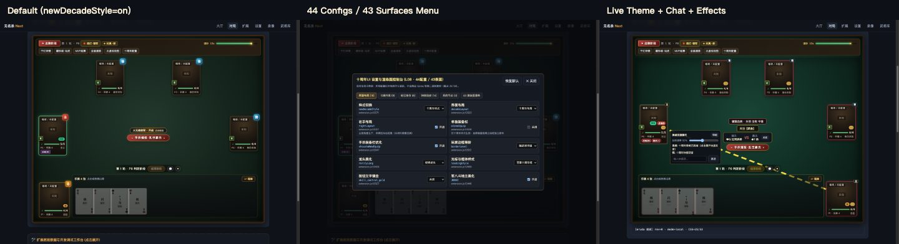

# Batch UI-2 Verification Evidence (`L08 十周年UI` 44 `configs` + 43 `surfaces`)

- Date: 2026-11-21
- Worktree / Branch: `/Users/ruyimg/Documents/Claude/sanguosha/.wt-conv-ui` (`swarm/conv-ui`, Batch UI-1 parent `c4248c6e072cb9d08a58dc0045caa839d6556f39`)
- Scope: Full cleanroom frontend consumption, interactive controls, persistence, schema validation, and CSS/JS runtime mapping for all 44 `L08:configs:*` and all 43 `L08:surfaces:*` (`10` JS modules + `33` CSS stylesheets) per Decisions 34, 35, 37, and 38 (no `spine.js` reads; no commercial `.skel`/`.atlas`/`.png`/audio assets bundled).

## Key Files

- Config schema, strict validation, mutual exclusions & `data-*` arena projection: [`apps/web-client/src/engine/surfaces/decadeConfigSchema.ts`](../../../../apps/web-client/src/engine/surfaces/decadeConfigSchema.ts)
- Wrap-around `decadeLayout="on"|"off"` perimeter geometry & seat center coords: [`apps/web-client/src/engine/surfaces/decadeTabletopLayout.ts`](../../../../apps/web-client/src/engine/surfaces/decadeTabletopLayout.ts)
- Cleanroom runtime for 10 JS + 33 CSS surfaces + strict JSON import guard: [`apps/web-client/src/engine/surfaces/decadeSurfacesRuntime.ts`](../../../../apps/web-client/src/engine/surfaces/decadeSurfacesRuntime.ts)
- Cleanroom CSS `data-*` selectors (all `cardSet`, `cardPrettify`, `cardBorder`, `outcropSkin`, `shoushaNewEquip`, `decadeLayout`, etc.): [`apps/web-client/src/styles/decadeSurfaces.css`](../../../../apps/web-client/src/styles/decadeSurfaces.css), [`apps/web-client/src/main.ts`](../../../../apps/web-client/src/main.ts)
- Hook dispatch & extension snapshot integration: [`apps/web-client/src/engine/surfaces/decadeUiSurface.ts`](../../../../apps/web-client/src/engine/surfaces/decadeUiSurface.ts), [`apps/web-client/src/engine/extensionSurfaceRuntime.ts`](../../../../apps/web-client/src/engine/extensionSurfaceRuntime.ts)
- Interactive UI & live tabletop bindings:
  - [`apps/web-client/src/components/battle/surfaces/DecadeConfigModal.vue`](../../../../apps/web-client/src/components/battle/surfaces/DecadeConfigModal.vue)
  - [`apps/web-client/src/components/battle/surfaces/DecadeTabletopOverlays.vue`](../../../../apps/web-client/src/components/battle/surfaces/DecadeTabletopOverlays.vue)
  - [`apps/web-client/src/components/battle/modals/BattleModalsHost.vue`](../../../../apps/web-client/src/components/battle/modals/BattleModalsHost.vue)
  - [`apps/web-client/src/components/battle/BattleShoushaHud.vue`](../../../../apps/web-client/src/components/battle/BattleShoushaHud.vue)
  - [`apps/web-client/src/components/battle/BattleBoard.vue`](../../../../apps/web-client/src/components/battle/BattleBoard.vue)
  - [`apps/web-client/src/components/battle/SeatCard.vue`](../../../../apps/web-client/src/components/battle/SeatCard.vue)
  - [`apps/web-client/src/components/battle/HandStrip.vue`](../../../../apps/web-client/src/components/battle/HandStrip.vue)
  - [`apps/web-client/src/components/battle/ExtensionSurfacePanel.vue`](../../../../apps/web-client/src/components/battle/ExtensionSurfacePanel.vue)
  - [`apps/web-client/src/components/battle/surfaces/UiSkinSuitePanel.vue`](../../../../apps/web-client/src/components/battle/surfaces/UiSkinSuitePanel.vue)
  - [`apps/web-client/src/views/BattleView.vue`](../../../../apps/web-client/src/views/BattleView.vue)
- Verification tests & CDP scripts:
  - [`apps/web-client/scripts/decade-configs-surfaces.test.mjs`](../../../../apps/web-client/scripts/decade-configs-surfaces.test.mjs)
  - [`apps/web-client/scripts/decade-configs-cdp.mjs`](../../../../apps/web-client/scripts/decade-configs-cdp.mjs)
  - [`apps/web-client/scripts/tabletop-responsive-cdp.mjs`](../../../../apps/web-client/scripts/tabletop-responsive-cdp.mjs)

## Verification Results (Post-Final-Edit, Round 2)

| Check | Outcome | Observed Summary |
|---|---|---|
| `pnpm --dir apps/web-client run typecheck` | Pass | `vue-tsc --noEmit` exit `0` |
| `pnpm --dir apps/web-client test` | Pass | `498` tests, `498` pass, `0` fail (1-to-1 `L08` 44 `configs` + 43 `surfaces`, strict import/schema validation, `decadeLayout` `"on"`/`"off"` anchor geometry) |
| `pnpm --dir apps/web-client run smoke:native` | Pass | `{"total":83,"failed":0}` (`37/37` / `46/46`) |
| `node apps/web-client/scripts/tabletop-responsive-cdp.mjs` | Pass | 2–8p desktop (`1440x1080`), tablet (`768x1024`, `1024x768`), mobile (`390x844`, `5p` `handBottom=801 <= 844`, `hudBtnCount=6`, `hudButtonsClipped=[]`, `overlaps=[]`, `overflowX=false`) |
| `node apps/web-client/scripts/decade-configs-cdp.mjs` | Pass | `44` configs, `33` CSS, `rightLayout` swap (`selfLeft: 188 -> 1091`), `decadeLayout="off"`, single-char `campIdentityImageMode` text badges, `chatOverlaps*=false` under both `rightLayout` settings, seat-center SVG line (`lineInsideP1=true`, `lineInsideP0=true`), real self equip `.alone-equip-dock` stacking (`dockBottom=741 <= handTop=745`, `portraitEquips=0`), strict JSON validation + Decision 38 rejection, reload persistence |
| `node apps/web-client/scripts/tabletop-comparison-cdp.mjs` | Pass | `avg_fps: 60`, `p95_ms: 16.67`, `seat_count: 5`, `hand_card_count: 7` |
| `node apps/web-client/scripts/decision34-browser-surfaces.mjs` | Pass | `passed: true`, `consoleErrors: []`, `approx_fps: 60` |

## Mainline Integration Verification (`main` @ `3686468ca` + Batch UI-2)

- `pnpm --dir apps/web-client run typecheck`: Pass (`vue-tsc --noEmit` exit `0`)
- `pnpm --dir apps/web-client test`: Pass (`498` tests, `498` pass, `0` fail)
- `pnpm --dir apps/web-client run build:native` & `pnpm --dir apps/web-client run smoke:native`: Pass (`{"total":83,"failed":0}`, `sources=37/37`, `packages=46/46`)
- `node apps/web-client/scripts/decade-configs-cdp.mjs`: Pass (`cfgCount: 44`, `uniqueCount: 44`, `cssCount: 33`, `aloneEquipCheck`: `dockBottom=741 <= handTop=745`, `portraitEquips=0`, `persistedCheck` pass)
- `TABLETOP_EVIDENCE_DIR=docs/operations/evidence-raw/ui-batch2-main node apps/web-client/scripts/tabletop-responsive-cdp.mjs`:
  - First run during parallel worktree builds timed out at 9s cold start waiting for `6p 1440x1080` (`players: 0`).
  - Re-run passed across all `2–8p` desktop (`1440x1080`), tablet (`768x1024`, `1024x768`), and mobile (`390x844`) viewports (`overlaps=[]`, `hudButtonsClipped=[]`).
- `TABLETOP_EVIDENCE_DIR=docs/operations/evidence-raw/ui-batch2-main node apps/web-client/scripts/tabletop-comparison-cdp.mjs`: Pass (`avg_fps: 60`, `p95_ms: 16.67`, `seat_count: 5`, `hand_card_count: 7`)
- `node apps/web-client/scripts/decision34-browser-surfaces.mjs`: Pass (`passed: true`, `consoleErrors: []`, `approx_fps: 60`)
- Note: Per `verifier-ui` independent audit (#39), `21` verified `L08:configs:*` items are upgraded to `已复核等价`; the remaining `23` `L08:configs:*` and `43` `L08:surfaces:*` remain `简化近似` until full consumer/visual feature parity is implemented cleanly without `spine.js` reads or bundled commercial assets.

## Side-by-Side Visual Thumbnail & Raw Checksums

- Tracked thumbnail (`62,323` bytes): [`decade-configs-side-by-side.jpg`](./decade-configs-side-by-side.jpg)

Raw full-resolution PNGs (gitignored under `docs/operations/evidence-raw/`):
- `docs/operations/evidence-raw/ui-batch2/raw-default-shizhounian.png`: `14cbb391a3ea15c52cde9df0b6d9004306d99ffc660ac556f4d0d5b2c32b47cb`
- `docs/operations/evidence-raw/ui-batch2/raw-decade-config-modal.png`: `8359758cd4bf9b57c240e7753296aa0a6b9ae0af5b60affd4dc33568c12990f5`
- `docs/operations/evidence-raw/ui-batch2/raw-themed-surfaces-active.png`: `9eb64e097a7d8430656d205c2d7840538bf4f73c76b7f43cd98135748c92f1d5`
- `docs/operations/evidence-raw/ui-batch2-main/tabletop-5p-mobile.png`: `6ce5ad1f6024246c020035d1bcc81587c265cf5ef0b2c0783166079ae415b4e0`
- `docs/operations/evidence-raw/ui-batch2-main/tabletop-8p-desktop.png`: `4a059404f6aeafaf106380fde6e1b23f6ba2361f67f72d004b605d9c4d10a78e`
- `docs/operations/evidence-raw/ui-batch2-main/tabletop-comparison.png`: `8447a7bbc6b82a0b7b1d286178a2f76dcc9f29478d54c29728770e7072be7475`
