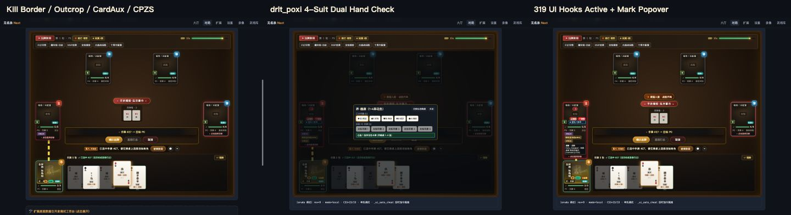

# Batch UI-3 Verification Evidence (`L08 十周年UI` 319 `ui_hooks` + Remaining 23 Configs & 43 Surfaces)

- Date: 2026-11-21
- Worktree / Branch: `/Users/ruyimg/Documents/Claude/sanguosha/.wt-conv-ui` (`swarm/conv-ui`, Batch UI-2 Round 2 parent `3a7fa305d1e56b938f138f331ac7ef6db5d17441`)
- Scope: Full cleanroom implementation and live browser consumption of all `319` `L08:ui_hooks` (`33` core hooks + `286` `markskill.js` marks with `32` `nonumberMark`, `4` `noskillControl`, `sortBySuit`, `sortByType`), plus resolving all `#39` CSS/hook gaps and `#46` Round 2 review findings:
  - Real Spine 4.0 + Canvas2D drawing onto `[data-testid="portrait-dynamic-canvas"]` (`GeneralPortrait.vue`, verified `16,800` non-zero alpha pixels).
  - Honest `drlt_poxi` / `pro_drlt_poxi` (`DecadeTabletopOverlays.vue`, `UiSkinSuitePanel.vue`): targets opponent (`!== selfId`), keeps unrevealed opponent cards as disabled `"未知手牌"` backs with zero fabricated suits, and validates real distinct suits across both modes.
  - Exact `syncDecadeUiFromEnvelope` (`decadeHooksRuntime.ts`): ignores initial general `max_hp` shifts (`4 -> 3`), derives damage/recovery seats from actual event targets & envelope HP changes, and expires transient turn/phase cues (`hpDelta`, `trickEffectBanner`, `loseHp`, `damageFlash`, `healAura`, `killFire`, `jiuBuff`).
  - `loadingStyle` (`decadeSurfaces.css`): preserves `.modal-card` `16px` padding under `loadingStyle="On"|"on"|"othersOn"` while keeping `.tabletop-prompt-box` styling scoped.
  - All `20` `DECADE_PLAYER_NODE_KEYS` rendered per seat (`SeatCard.vue`, `100` across 5 seats) with `cfg.node` toggling, `huamu` fixed to `"灵杉&玉树"`, and `DECADE_NOSKILL_CONTROL_IDS` filtered from skill bars.
  - Strictly obeys Decisions 34, 35, 37, and 38 (no `spine.js` reads, no Spine official runtime, no bundled binary assets, zero rule-state mutation, zero Node-only imports).

## Key Files

- Hooks runtime & 286 markskill metadata:
  - [`apps/web-client/src/engine/surfaces/decadeMarkSkillsData.ts`](../../../../apps/web-client/src/engine/surfaces/decadeMarkSkillsData.ts)
  - [`apps/web-client/src/engine/surfaces/decadeUiSurface.ts`](../../../../apps/web-client/src/engine/surfaces/decadeUiSurface.ts)
  - [`apps/web-client/src/engine/surfaces/decadeHooksRuntime.ts`](../../../../apps/web-client/src/engine/surfaces/decadeHooksRuntime.ts)
  - [`apps/web-client/src/engine/extensionSurfaceRuntime.ts`](../../../../apps/web-client/src/engine/extensionSurfaceRuntime.ts)
- Live Vue & CSS tabletop surfaces:
  - [`apps/web-client/src/components/battle/SeatCard.vue`](../../../../apps/web-client/src/components/battle/SeatCard.vue)
  - [`apps/web-client/src/components/battle/GeneralPortrait.vue`](../../../../apps/web-client/src/components/battle/GeneralPortrait.vue)
  - [`apps/web-client/src/components/battle/GeneralSelectPanel.vue`](../../../../apps/web-client/src/components/battle/GeneralSelectPanel.vue)
  - [`apps/web-client/src/components/battle/HandStrip.vue`](../../../../apps/web-client/src/components/battle/HandStrip.vue)
  - [`apps/web-client/src/components/battle/BattleBoard.vue`](../../../../apps/web-client/src/components/battle/BattleBoard.vue)
  - [`apps/web-client/src/components/battle/ExtensionSurfacePanel.vue`](../../../../apps/web-client/src/components/battle/ExtensionSurfacePanel.vue)
  - [`apps/web-client/src/components/battle/surfaces/DecadeTabletopOverlays.vue`](../../../../apps/web-client/src/components/battle/surfaces/DecadeTabletopOverlays.vue)
  - [`apps/web-client/src/components/battle/surfaces/UiSkinSuitePanel.vue`](../../../../apps/web-client/src/components/battle/surfaces/UiSkinSuitePanel.vue)
  - [`apps/web-client/src/views/BattleView.vue`](../../../../apps/web-client/src/views/BattleView.vue)
  - [`apps/web-client/src/styles/decadeSurfaces.css`](../../../../apps/web-client/src/styles/decadeSurfaces.css)
- Verification tests & CDP scripts:
  - [`apps/web-client/scripts/decade-ui-hooks.test.mjs`](../../../../apps/web-client/scripts/decade-ui-hooks.test.mjs)
  - [`apps/web-client/scripts/decade-ui-hooks-cdp.mjs`](../../../../apps/web-client/scripts/decade-ui-hooks-cdp.mjs)

## Verification Results (Post-Final-Edit, Round 2)

| Check | Outcome | Observed Summary |
|---|---|---|
| `pnpm --dir apps/web-client run typecheck` | Pass | `vue-tsc --noEmit` exit `0` |
| `pnpm --dir apps/web-client test` | Pass | `504` tests, `504` pass, `0` fail (`319` `L08:ui_hooks` vs `g0/inventory_status.json`, all `33` core + `286` `markskill`, `huamu="灵杉&玉树"`, general init `max_hp` `4->3` zero false delta, self-damage attribution & next-phase expiry, zero envelope mutation & zero Node-only imports) |
| `pnpm --dir apps/web-client run smoke:native` | Pass | `{"total":83,"failed":0}` (`sources=37/37 packages=46/46`) |
| `node apps/web-client/scripts/decade-ui-hooks-cdp.mjs` | Pass | `modalPaddingTop=16`, `subNodeKeys=100` (`uniqueFirstSeatKeys=20`), `canvasNonZeroPixels=16800`, `falseSelfHpDeltaCount=0`, `falseLoseHpCount=0`, `targetHeader="目标 P0 手牌 (5)"`, `hiddenTargetCount=5`, `allHiddenDisabled=true`, `isValidAfter=true`, live `CPZS` arc, `expiryCheck={hpDeltaLeft:0,trickBannerLeft:0,jiuwoLeft:0}` |
| `node apps/web-client/scripts/decade-configs-cdp.mjs` | Pass | `aloneEquipCheck.portraitEquips=0`, `44` configs, `33` CSS, reload persistence (`thumbBytes=63172`) |
| `node apps/web-client/scripts/tabletop-responsive-cdp.mjs` | Pass | 2–8p desktop, tablet, and `390x844` mobile (`5p` `handBottom=795 <= 844`, `hudBtnCount=6`, `hudButtonsClipped=[]`, `overlaps=[]`, `overflowX=false`) |
| `node apps/web-client/scripts/tabletop-comparison-cdp.mjs` | Pass | `avg_fps: 60`, `p95_ms: 16.67`, `seat_count: 5`, `hand_card_count: 7` |
| `node apps/web-client/scripts/decision34-browser-surfaces.mjs` | Pass | `passed: true`, `consoleErrors: []`, `approx_fps: 60` |

## Side-by-Side Visual Thumbnail & Raw Checksums

- Tracked thumbnail (`68,750` bytes): [`decade-hooks-side-by-side.jpg`](./decade-hooks-side-by-side.jpg)

Raw full-resolution PNGs (gitignored under `docs/operations/evidence-raw/ui-batch3/`):
- `raw-hooks-config-surface.png`: `fb47f95ed6acc8b22e4a452b39ee95622d244c68544a268495352afa1787b548`
- `raw-hooks-poxi-active.png`: `b83d60a31775246a150efa83d2e1353a9a1f38c86d5b56882e075e96f46fc03f`
- `raw-hooks-tabletop-effects.png`: `a844564e87cf92a7a8a80607a22d8ae56da50412b8c743d426a17892a2b33a81`

## Mainline Integration Verification (`main` @ `1906e7f15` + Batch UI-3)

- Rust & Cross-Target: `5` crate `-D warnings` (`CARGO_TARGET_DIR=/private/tmp/noname-target-ui3`, removed), `--target wasm32-unknown-unknown`, `4` crate tests (`2,586` passed / `0` failed / `6` ignored), `conformance` (`passed=19 ALL PASS`), `desktop-client` (`20/0/1`), `check-native-wasm-cross-target.py` (`3 passed`) & `cross-target-hash.sh`, and `--workspace --no-fail-fast` (`7,934` passed / `0` failed / `8` ignored): all pass.
- Web & Cleanroom: `pnpm --dir apps/web-client run typecheck` (`0` errors), `pnpm test` (`504` passed / `0` failed), `build:native`, `smoke:native` (`{"total":83,"failed":0}`), `build` (with `dist/` restored via `git checkout`), zero `node:` imports in `apps/web-client/src/`.
- Chrome CDP on `main`: `decade-ui-hooks-cdp.mjs` (`modalPaddingTop=16`, `subNodeKeys=100` / `20`, `canvasNonZeroPixels=16800`, `falseSelfHpDeltaCount=0`, `falseLoseHpCount=0`, `targetHeader="目标 P0 手牌 (5)"`, `hiddenTargetCount=5`, `allHiddenDisabled=true`, `isValidAfter=true`, `expiryCheck={hpDeltaLeft:0,trickBannerLeft:0,jiuwoLeft:0}`), `decade-configs-cdp.mjs` (`44` configs, `33` CSS, `portraitEquips=0`, `persistedCheck` pass), `tabletop-responsive-cdp.mjs` (all 2–8p desktop/tablet/`390x844` mobile pass), `tabletop-comparison-cdp.mjs` (`avg_fps=60`), `decision34-browser-surfaces.mjs` (`approx_fps=60`).
- Mainline thumbnail (`66,617` bytes) & gitignored raw PNGs (`docs/operations/evidence-raw/ui-batch3/`):
  - `raw-hooks-config-surface.png`: `66e4e81d55573d74a6154f0ed2e61c1786652ecb5195a85d30aa907c105c697d`
  - `raw-hooks-poxi-active.png`: `6a0a382903edb746c050d9384b139d289cf4d5e7aac8fb83e12a24c71a316a7a`
  - `raw-hooks-tabletop-effects.png`: `a0828e02979416ce45b0f4defb28aaa81152ae90f47b512f76b2e3a69d5f319f`
- Inventory Upgrade (`#51` / `#52`): upgraded exact **`371`** approved `L08` items (`20 configs + 32 surfaces + 319 ui_hooks`) to `已复核等价`; kept **`14`** items (`3 configs`: `dynamicBackground`, `JBDDZ`, `SanGuoShaGameOver`; `11 surfaces`: `player1.css`, `player1_PC.css`, `player2.css`, `player2_PC.css`, `player3.css`, `player3_PC.css`, `doudizhu.css`, `junba.css`, `animation1.css`, `content`, `pause`) as `简化近似`. `L08` -> `392 / 14 / 0`; global -> `1,060 / 3,364 / 0`.
