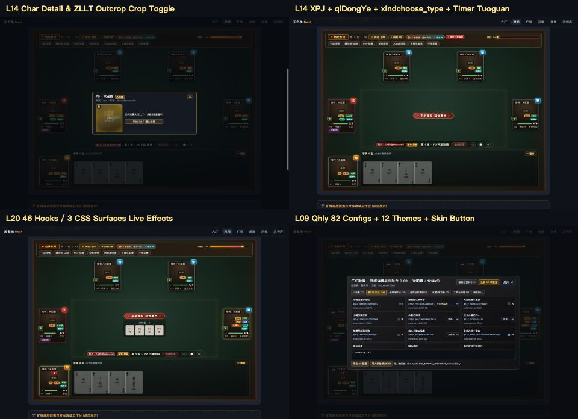

# Batch UI-5 证据记录：L14 终闭环 (141/141)、L20 标记补充 (全量) 与 L09 千幻聆音 (102/102)

- **核验日期**: 2026-11-21
- **分支 / 工作区**: `swarm/conv-ui` (`noname-next` Batch UI-5)
- **源码边界**: 净室前端实现，零 Spine 二进制/闭源商业资产依赖，不修改 Rust crates、`inventory_status.json`、共享进度台账与规则版本锁。

## 1. L14 手杀ui 剩余 33 项补全 (`9 configs + 1 ui_hook + 23 surfaces` → `141/141`)

| 项别 | 实现文件 | CDP / 单测实测证据 |
| --- | --- | --- |
| `qiDongYe` (`"on"`/`"othersOn"`/`"othersTwo"`/`"off"`) | [shoushaSurfacesRuntime.ts](../../../../apps/web-client/src/engine/surfaces/shoushaSurfacesRuntime.ts), [shoushaConfigSchema.ts](../../../../apps/web-client/src/engine/surfaces/shoushaConfigSchema.ts), [shoushaSurfaces.css](../../../../apps/web-client/src/styles/shoushaSurfaces.css) | 严格对齐上游 `extension.js:168-177`：`on->layout_old.css`、`othersOn->layout_new.css`、`othersTwo->layout_new.css + layout_xbig.css`、`off->空` |
| `ZLLT` 资料页露头裁剪与详情弹窗 (`charactermenu`) | [ShoushaCharDetailModal.vue](../../../../apps/web-client/src/components/battle/surfaces/ShoushaCharDetailModal.vue), [SeatCard.vue](../../../../apps/web-client/src/components/battle/SeatCard.vue), [BattleBoard.vue](../../../../apps/web-client/src/components/battle/BattleBoard.vue) | 点击座位官阶徽章打开详情弹窗并实时切换 `[data-zllt-outcrop="on"|"off"]` (`beforeAttr="on" -> afterAttr="off"`)；同步支持 `charactermenu` `old`/`new`/`none` |
| `XPJ` / `xindchoose_type` / `xindmenu` / `GTBBTime` | [BattleBoard.vue](../../../../apps/web-client/src/components/battle/BattleBoard.vue), [BattleShoushaHud.vue](../../../../apps/web-client/src/components/battle/BattleShoushaHud.vue), [shoushaSurfaces.css](../../../../apps/web-client/src/styles/shoushaSurfaces.css) | `yangshi="off"` 实测渲染 `配件·原版`；`xindchoose_type="old"` 选将框实测 `borderTopLeftRadius="4px"`；`xindmenu` 切换 `shizhounian`；`GTBBTime` 控制播报轮播节奏 |
| `jindutiaoST` + `jindutiaotuoguan` | [BattleBoard.vue](../../../../apps/web-client/src/components/battle/BattleBoard.vue), [BattleShoushaHud.vue](../../../../apps/web-client/src/components/battle/BattleShoushaHud.vue) | 真实对局行动超时后触发 `[data-testid="shousha-tuoguan-indicator"]` (`tuoguanOk=true`) |
| 其余 23 项 JS/CSS 表面实时消费 | [shoushaSurfaces.css](../../../../apps/web-client/src/styles/shoushaSurfaces.css), [BattleBoard.vue](../../../../apps/web-client/src/components/battle/BattleBoard.vue) | 通过 `[data-shousha-active-surfaces]` 差异化消费全部 `dialog/*`、`card/*`、`menu*`、`lbtn/*`、`skill/*`、`character/*`、`KGMH/*`、`style_boss.css`；`390×844` 移动视口实测切换至 `main2.css` 且移出 `main2_window.css` |

## 2. L20 标记补充 全量实现 (`46 ui_hooks + 3 surfaces + 15 configs`)

- **运行时与钩子分派**: [l20MarkSupplementRuntime.ts](../../../../apps/web-client/src/engine/surfaces/l20MarkSupplementRuntime.ts) 1-to-1 覆盖清单全部 46 个 `ui_hooks`（含 34 项此前 `简化近似` 与 12 项既有等价钩子，涵盖暴击 `baojiA..H`、刀剑斧 `daojianfu_type`、`shoushajisha`、癫狂屠戮、万军取首、妙手回春/医术高超/免伤、兵临城下 `jiangling/xiangyang/fancheng/jianxi`、`player_game_guagua` 星级、`guozhan` 阵型/全局标记等）、全部 15 个 `L20` 配置与 3 份 CSS 表面 (`extension.css`, `group.css`, `mark.css`)。
- **牌桌消费**: [l20MarkSurfaces.css](../../../../apps/web-client/src/styles/l20MarkSurfaces.css)、[SeatCard.vue](../../../../apps/web-client/src/components/battle/SeatCard.vue)、[BattleBoard.vue](../../../../apps/web-client/src/components/battle/BattleBoard.vue) 与 [extensionSurfaceRuntime.ts](../../../../apps/web-client/src/engine/extensionSurfaceRuntime.ts) 联动；CDP 实测 `[data-l20-surfaces]="extension.css group.css mark.css"`，实局步进出现 `weapons=1`、`cardFx=1`、`rankSweepSeats=3` 与实时伤血提示。

## 3. L09 千幻聆音 全量实现 (`82 configs + 8 ui_hooks + 12 surfaces = 102/102`)

- **82 项配置 Schema 与裁决 38 导入校验**: [qhlyConfigSchema.ts](../../../../apps/web-client/src/engine/surfaces/qhlyConfigSchema.ts) 与 `docs/migration/g0/inventory_status.json` (`source_id == "L09"`) 逐键 1-to-1 对齐（涵盖 7 UI、34 窗口/立绘、14 十周年联动、8 音效/防啰嗦 `qhly_notbb`、11 水墨/海克斯行高/字号/封面隐藏、8 工具/清理/JSON 槽位），[QhlyConfigPanel.vue](../../../../apps/web-client/src/components/battle/surfaces/QhlyConfigPanel.vue) 实测导出/导入及非法键 `{"badQhly":1}` 拒绝 (`导入被拒绝：QHLY_CONFIG_IMPORT_UNKNOWN_KEY:badQhly`)。
- **12 份渲染面与 8 项 UI 钩子**: [qhlySurface.ts](../../../../apps/web-client/src/engine/surfaces/qhlySurface.ts)、[qhlySurfaces.css](../../../../apps/web-client/src/styles/qhlySurfaces.css)、[QhlyDetailModal.vue](../../../../apps/web-client/src/components/battle/modals/QhlyDetailModal.vue) 与 [SeatCard.vue](../../../../apps/web-client/src/components/battle/SeatCard.vue) 消费全部 12 套预设 (`qhlySheetCount=12`、`newui_shuimo.css`、`qhly_fontsize1="8" -> 15.34px`)，启用 `qhly_skinButton` 后牌桌渲染 5 个独立可点/可拖拽偏移的 `.seat-qhly-skin-btn`（`6px -> 12px`），刷新页面 (`Page.reload`) 后配置与按钮持久化保留。

## 4. 核验命令与证据文件

- `pnpm --dir apps/web-client run typecheck`: `0` 错误。
- `pnpm --dir apps/web-client test`: **514 / 514** 通过（0 失败 / 0 跳过；含新增 [l20-l09-l14-closure.test.mjs](../../../../apps/web-client/scripts/l20-l09-l14-closure.test.mjs)）。
- `pnpm --dir apps/web-client run smoke:native`: `{"total":83,"failed":0}`。
- Batch UI-5 Chrome CDP ([l14-l20-l09-ui-cdp.mjs](../../../../apps/web-client/scripts/l14-l20-l09-ui-cdp.mjs)): exit `0`。
- 全量回归 CDP 套件 (`tabletop-responsive-cdp.mjs` 2–8p 桌面/平板/手机 `5p 390×844` `handBottom=831<=844` `hudBtnCount=7` `overlaps=[]`、`decade-configs-cdp.mjs`、`decade-ui-hooks-cdp.mjs`、`shousha-ui-cdp.mjs`、`decision34-browser-surfaces.mjs` `consoleErrors=[]`、`tabletop-comparison-cdp.mjs` `avg_fps=60`)：全绿通过。

| 文件 | 大小 / 用途 | SHA-256 |
| --- | --- | --- |
| `docs/operations/evidence/2026-11-21-ui-l14-l20-l09/ui-batch5-l14-l20-l09.jpg` | `72,345 B` (`<= 200 KB`) 2×2 实测拼图 | — |
| `docs/operations/evidence-raw/ui-batch5/raw-l14-char-zllt-detail.png` | `1440×1080` 手杀武将详情弹窗与 `ZLLT` 露头裁剪 | `3d9133426f62f5bd6a6781847005e8cd9cd87ff0d4335ad3cd9417e430e4dea3` |
| `docs/operations/evidence-raw/ui-batch5/raw-l14-xpj-qidongye-choose.png` | `1440×1080` `XPJ` + `qiDongYe` + `xindchoose_type` + 倒计时托管 | `7ae2160fac572017c0b34a7d17b14bf104061668202125d96f7f91ad5b1d197f` |
| `docs/operations/evidence-raw/ui-batch5/raw-l20-effects-live.png` | `1440×1080` `L20` 46 钩子 / 3 表面实时牌桌特效 | `37130b68ffc44f33815ab51a1a64c5f9778b341c1c61509d9e3f8879d6d14b14` |
| `docs/operations/evidence-raw/ui-batch5/raw-l09-qhly-82-configs.png` | `1440×1080` 千幻聆音 82 项配置面板与 12 套主题切换 | `1abc1698093aef054babcef8c893e3d2bd097c4dd09fb403ab28efb350cf392a` |

## 5. 主线合入复测与诚实清单口径（`main` @ `586b51cdc` + Batch UI-5）

- **Rust 与跨端门禁**：5 crate `-D warnings`（`CARGO_TARGET_DIR=/private/tmp/noname-target-ui5`，已清理）、`--target wasm32-unknown-unknown`、4 crate `2,600` passed / `0` failed / `6` ignored、`conformance` `19/19 ALL PASS`（单测 `4/0`）、`desktop-client` `20/0/1`、`check-native-wasm-cross-target.py` (`final_revision: 40`/`20`, `native_wasm_match: true`) & `cross-target-hash.sh`、`--workspace --no-fail-fast` (`7,948` passed / `0` failed / `8` ignored) 全通过。
- **前端与 7 套 Chrome CDP 实测**：`typecheck` (`0` errors)、`pnpm test` (`514/0`)、`build:native`、`smoke:native` (`{"total":83,"failed":0}`、`sources=37/37 packages=46/46`)、`build`（已清理 `dist/`），及 `l14-l20-l09-ui-cdp.mjs`、`shousha-ui-cdp.mjs`、`decade-ui-hooks-cdp.mjs`、`decade-configs-cdp.mjs`、`tabletop-responsive-cdp.mjs`（2–8p 桌面/平板/手机 12 组矩阵 `overlaps=[]`、`hudButtonsClipped=[]`）、`tabletop-comparison-cdp.mjs`（`avg_fps=60`）、`decision34-browser-surfaces.mjs`（`passed=true`, `approx_fps=60`, `consoleErrors=[]`）全通过；主线复测缩略图 `ui-batch5-l14-l20-l09.jpg`（`71,034 B` `<= 200 KB`）与 `evidence-raw/ui-batch5/` 重跑校验和：`raw-l14-char-zllt-detail.png` (`b24b6745c0110767e56388d1038f8eadb74cd2eb07eff45da6f013d23674a095`)、`raw-l14-xpj-qidongye-choose.png` (`593d6d615078d9fa4c4c34cba6dc642d867565472a23ae395599738b52a6465c`)、`raw-l20-effects-live.png` (`b7175c4e0a157a521cd42a17554353b5d4ae94d9f183d29e613bb9943cedd9e6`)、`raw-l09-qhly-82-configs.png` (`caca640e01d0e55351b4f3b389192398cc4eb1070852f1d7f6cd5186596b5962`)。
- **独立复核与清单升级边界（`#77` `APPROVE`，净 +118 项）**：
  - `L14 手杀ui` 终 **33** 项（`9` 配置 `GTBBTime`/`XPJ`/`ZLLT`/`charactermenu`/`jindutiaoST`/`jindutiaotuoguan`/`qiDongYe`/`xindchoose_type`/`xindmenu` + `1` 钩子 `ZLLT` + `23` 变体表面）全数升为 `已复核等价`，`L14` 达 **`141 / 0 / 0`**（100% 单项等价；非整包签署）。
  - `L20 标记补充` 仅升格 **27** 项（`3` 表面 `extension.css`/`group.css`/`mark.css` + `24` 视觉挂钩 `ui_hooks`）；保留 **10** 项无有效 DOM/CSS 消费的 `ui_hooks`（`_guozhanhalfchghp`、`_o_o_recovertrigger`、`_losehp_`、`_mianshang_`、`_binglintu`、`_dysp`、`_guozhanChooseControlCHG`、`_guozhan_marks`、`_guozhan_diebiaoji_`、`_chongzhu`）与 `3` 项规则技能（`fz_liegong`/`mibei`/`wengua` 待规则批次 Q2-L20）为 `简化近似`，`L20` 计为 **`82 / 13 / 0`**。
  - `L09 千幻聆音` 仅升格 **58** 项（`12` 表面 + `8` `ui_hooks` + `38` 配置含 10 分组槽位与 28 项真实消费配置）；保留 **44** 项未消费配置（23 面板/拖拽项 + 21 外部资产/动皮参数项）为 `简化近似`，`L09` 计为 **`58 / 44 / 0`**。全仓总计更新为 **`1,304 / 3,120 / 0 / 0`**（合计 4,424；整包八项仍 `0/37`）。
