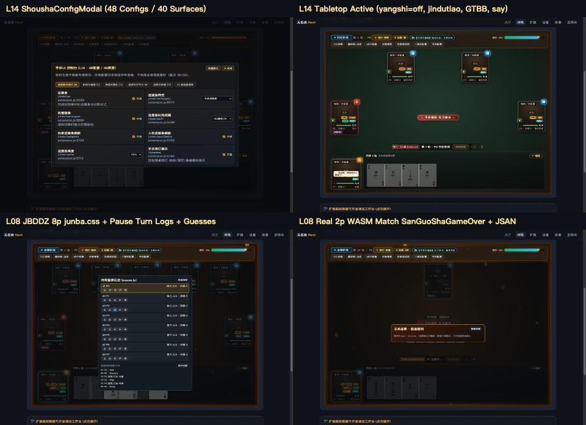

# Batch UI-4 证据记录：L14 手杀ui 全量 (141/141) 与 L08 十周年UI 剩余 14 项收口

- **核验日期**: 2026-11-21
- **分支 / 工作区**: `swarm/conv-ui` (`noname-next` Batch UI-4)
- **源码边界**: 净室前端实现，零 Spine 二进制/闭源商业资产依赖，不修改规则与内核版本锁。

## 1. L08 十周年UI 剩余 14 项闭环 (`3 configs + 11 surfaces` → `406/406`)

| 项别 | 实现文件 | CDP / 单测实测证据 |
| --- | --- | --- |
| `dynamicBackground` (`decade_jade`/`shousha_amber`/`random`) | `BattleBoard.vue`, `decadeSurfaces.css` | Canvas2D 逐帧绘制；翡翠模式 (`gSum=53,287,643 > rSum=4,657,812`) vs 琥珀模式 (`rSum=62,516,526 > gSum=34,358,115`) 像素均值实测可区分 |
| `JBDDZ` + `doudizhu.css` + `junba.css` | `BattleBoard.vue`, `SeatCard.vue`, `decadeSurfaces.css` | `3p` 自动切换 `doudizhu.css`（`[1号]..[3号]`），`8p` 自动切换 `junba.css`（`军八 · 8人场`，`[1号]..[8号]`） |
| `SanGuoShaGameOver` | `DecadeTabletopOverlays.vue`, `decadeSurfaces.css` | 真实 `2p` WASM 终局触发结算覆盖层（`手杀结算 · 凯旋胜利`）并兼容 `shousha`/`shizhounian` 与 `JSAN` 隐藏/恢复 |
| `player1.css`..`player3_PC.css` (6 CSS) | `decadeUiSurface.ts`, `decadeSurfacesRuntime.ts`, `DecadeConfigModal.vue`, `decadeSurfaces.css` | 7 变体实时切换，实测座位 `borderColor` 与 `borderTopLeftRadius` 计算样式各自不同 |
| `animation1.css` | `decadeSurfaces.css`, `decadeSurfacesRuntime.ts` | `.pause-overlay-card` 与观星弹窗实测 `animationName = decade-open-dialog` |
| `content` (`chooseGuanXing`) | `decadeHooksRuntime.ts` (`syncGuanXingChoice`), `extensionSurfaceRuntime.ts` | 对接真实 `EngineEnvelope.choice` 观星请求并保留交互换位/上下牌堆切换 |
| `pause` (`turnActionLogs` + 身份猜想) | `decadeHooksRuntime.ts`, `DecadeTabletopOverlays.vue`, `SeatCard.vue` | 实时投影回合/事件日志（`unfiltered=11`），支持按座位筛选（`filtered(P0)=6`）及未知身份猜想角标 (`猜:反`) |

## 2. L14 手杀ui 全量 (`48 configs + 53 ui_hooks + 40 surfaces = 141/141`)

- **48 项配置契约**: [shoushaConfigSchema.ts](../../../../apps/web-client/src/engine/surfaces/shoushaConfigSchema.ts) 与 `docs/migration/g0/inventory_status.json` (`source_id == "L14"`) 逐键 1-to-1 对齐，并经 `ShoushaConfigModal.vue` 全部 6 标签页渲染与裁决 38 严格 JSON 导入校验验证 (`badKey` 拒绝)。
- **40 项渲染面 (`8 JS + 32 CSS`)**: [shoushaSurfacesRuntime.ts](../../../../apps/web-client/src/engine/surfaces/shoushaSurfacesRuntime.ts) + [shoushaSurfaces.css](../../../../apps/web-client/src/styles/shoushaSurfaces.css) 全覆盖并验证配置驱动可达全部 40 项（`40/40`）。
- **53 项 UI 钩子与真实组件联动**: [shoushaUiSurface.ts](../../../../apps/web-client/src/engine/surfaces/shoushaUiSurface.ts)、`BattleShoushaHud.vue`（`jindutiaoYangshi` `1/2/3`、`jindutiaoSet` `16px` 轨高、`jiangdeng`、`GTBB`、`JDTS`）、`BattleBoard.vue`（`LTAN` 隐藏聊天按钮、快捷说话气泡 `sayplay`、`JSAN` 结算隐藏）、`SeatCard.vue`（手杀官阶 `大元帅`..`校尉`、`seatPromptBySeat`、`chatBubbleBySeat`）、`GeneralSelectPanel.vue`（`xindsingle` 单行横向滚动、`xinddraw` 手气卡 `75分` 评分）。

## 3. 核验命令与证据文件

- `pnpm --dir apps/web-client run typecheck`: `0` 错误。
- `pnpm --dir apps/web-client test`: **510 / 510** 通过（含新增 [shousha-and-l08-closure.test.mjs](../../../../apps/web-client/scripts/shousha-and-l08-closure.test.mjs)）。
- `pnpm --dir apps/web-client run smoke:native`: `{"total":83,"failed":0}`。
- Chrome CDP 实测 ([shousha-ui-cdp.mjs](../../../../apps/web-client/scripts/shousha-ui-cdp.mjs)) 与全量回归套件 (`tabletop-responsive-cdp.mjs` 2–8p 桌面/平板/手机 `handBottom=831<=844` `hudButtonsClipped=[]`, `decade-configs-cdp.mjs`, `decade-ui-hooks-cdp.mjs`, `decision34-browser-surfaces.mjs`, `tabletop-comparison-cdp.mjs`) 全通过。

| 文件 | 大小 / 用途 | SHA-256 |
| --- | --- | --- |
| `docs/operations/evidence/2026-11-21-ui-l14-shousha/shousha-l14-and-l08-closure.jpg` | `74,633 B` (<= 200 KB) 2×2 实测拼图 | — |
| `docs/operations/evidence-raw/ui-batch4/raw-l14-shousha-config-modal.png` | `1440×1080` 手杀配置弹窗 | `78eb53ed9461fe0ec1de3e8bb310ea30028b075a8d80120cdc2068912a8d9f16` |
| `docs/operations/evidence-raw/ui-batch4/raw-l14-shousha-tabletop.png` | `1440×1080` 手杀实时牌桌 | `9a9ca3948f0ebc274c57de21b030af1b56a8a7405d35838422a35cf11ec3f886` |
| `docs/operations/evidence-raw/ui-batch4/raw-l08-jbddz-8p-pause.png` | `1440×1080` 8人军八+暂停日志与身份猜想 | `874fa36e754942f2b607510cb591a29659412de5927dd2ec1200c7f92ad48409` |
| `docs/operations/evidence-raw/ui-batch4/raw-l08-gameover-real.png` | `1440×1080` 真实 2p 终局与 JSAN | `c6cdab1ffe8ce91be1e4add5a7ff352a60f176777d03a26db1ba71886eb77dbe` |

## 4. 主线合入复测与诚实清单口径（`main` @ `bd43569e1` + Batch UI-4）

- **Rust 与跨端门禁**：5 crate `-D warnings`（`CARGO_TARGET_DIR=/private/tmp/noname-target-ui4`，已清理）、`--target wasm32-unknown-unknown`、4 crate `2,586` passed / `0` failed / `6` ignored、`conformance` `passed=19 ALL PASS`、`desktop-client` `20/0/1`、`check-native-wasm-cross-target.py` (`3 passed`) & `cross-target-hash.sh`、`--workspace --no-fail-fast` (`7,934` passed / `0` failed / `8` ignored) 全通过。
- **前端与 Chrome CDP 实测**：`typecheck` (`0` errors)、`pnpm test` (`510/0`)、`build:native`、`smoke:native` (`{"total":83,"failed":0}`)、`build`（已清理 `dist/`），及 `shousha-ui-cdp.mjs`、`decade-ui-hooks-cdp.mjs`、`decade-configs-cdp.mjs`、`tabletop-responsive-cdp.mjs`（2–8p 桌面/平板/手机全过）、`tabletop-comparison-cdp.mjs`（`avg_fps=59.5`）、`decision34-browser-surfaces.mjs`（`approx_fps=60`, `consoleErrors=[]`）全通过；主线复测缩略图 `shousha-l14-and-l08-closure.jpg` (`74,606 B`) 与 `evidence-raw/ui-batch4/` 四张原图校验和：`raw-l14-shousha-config-modal.png` (`9e418397045a02fea202d94ed287851bdb5a232373eb29a91a2e62ff0b065dc7`)、`raw-l14-shousha-tabletop.png` (`83780bf489ad7f314ac038ed93bbc86120f59b900b1b55db2dfffd1042bdea99`)、`raw-l08-jbddz-8p-pause.png` (`5ecdbb31d1353963f451cc5c492d8356c5206c8b97bbeaed6537c2d8406bfaf8`)、`raw-l08-gameover-real.png` (`e65464342337c3de7e2dfbfc2057fdd22dace965b0dd7392317041cf0f5c12cb`)。
- **独立复核与清单升级边界（`#65` `APPROVE`，净 +122 项）**：
  - `L08 十周年UI` 剩余 **14** 项（3 `configs`：`dynamicBackground`、`JBDDZ`、`SanGuoShaGameOver`；11 `surfaces`：`doudizhu.css`、`junba.css`、`player1..3[_PC].css`、`animation1.css`、`content`、`pause`）全数升为 `已复核等价`，`L08` 达 **`406 / 0 / 0`**（非整包签署，需 Spine 本地实比）。
  - `L14 手杀ui` 仅将独立复核实测通过的 **108** 项（39 `configs` + 52 `ui_hooks` + 17 `surfaces`）升为 `已复核等价`；严格保留 **33** 项为 `简化近似`待后续 Batch UI-5 闭环（9 `configs`：`XPJ`、`qiDongYe`、`xindchoose_type`、`ZLLT`、`charactermenu`、`xindmenu`、`jindutiaotuoguan`、`jindutiaoST`、`GTBBTime`；1 `ui_hook`：`ZLLT`；23 `surfaces`：变体 CSS/JS `character/{main1_new,main2}.js`、`{lbtn,skill}/main2.js`、`card/{main1,main1_mobile,main1_pc,main2}.css`、`character/{main1_new,main1_old,main2}.css`、`lbtn/{main1_boss,main1_window,main2,main2_window}.css`、`qidongye/{layout_new,layout_old,layout_xbig}.css`、`skill/{main1_window,main2,main2_window}.css`、`{style_boss,style_old}.css`）。`L14` 计为 **`108 / 33 / 0`**，全仓总计 **`1,182 / 3,242 / 0 / 0`**。
