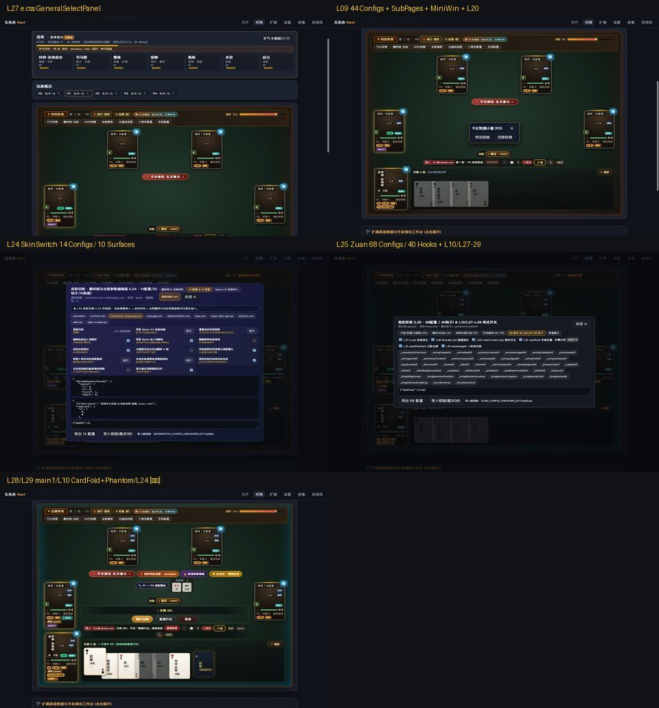

# Batch UI-6 Evidence: L20 / L09 Closure + L24 / L25 / L27 / L28 / L29 / L10

- **主线基线 HEAD**：`920f4fac0c5fa4b84da906f453e90e1d9f459483`（Batch U01-1 已发布并入 [CI 运行台账](../ci-runs.md)，CI Run `44963498759` Attempt 1 `10/10 success`）
- **合入来源**：`swarm/conv-ui` `77fd89711..5eb822daa0ea6afd876be616286c35c5fa9e0384`（`verifier-ui` #109 **`APPROVE`**）
- **版本与内容锁**：规则 `333` / NGSA `107` / content schema `5` / ABI `759` / WS `8`（零变更）；14 项标准 golden 哈希与 `u01-dddanzhi-pending-v107.ngsa` 不变
- **清单变更**：全仓 `1,333 / 3,091 / 0` -> **`1,491 已复核等价 / 2,933 简化近似 / 0 缺失`**（`+158`：`L20` +10 `ui_hooks` -> `92/3/0`；`L09` +44 `configs` -> `102/0/0`；`L24` 全 +46 -> `46/0/0`；`L25` 纯 UI +21 `configs`/+25 `ui_hooks` -> `239/18/0`，保留 `ssr_luoyi`/`ssr_lieren`/`ssr_jinfan`/4 规则钩子/11 技能在 Queue 2；`L27` +1 `e.css` -> `54/0/0`；`L28` +1 `thunder.css` -> `55/1/0`；`L29` +4 -> `9/0/0`；`L10` +6 -> `17/0/0`），整包八项签署仍 `0/37`
- **Side-by-side collage**:  (`101,437 B`)

## Scope Closed
1. **L20 十周年UI / 国战标记补齐**: remaining `10` `ui_hooks` (`_guozhanhalfchghp`, `_o_o_recovertrigger`, `_losehp_`, `_mianshang_`, `_binglintu`, `_dysp`, `_guozhanChooseControlCHG`, `_guozhan_marks`, `_guozhan_diebiaoji_`, `_chongzhu`) wired to `guozhanHalfHpBySeat`, `HpLost`, CSS cues, and control state.
2. **L09 千幻聆音**: remaining `44` `configs` (`23` UI/panel/drag/list + `21` external-asset/dynamic-skin parameters under Decision 38), `_qhly_randskin` gated by `qhly_randskin`, `qhly_smallwiningame` mini drawer, `qhly_recordWin`, `qhly_editmode`, `qhly_dom2image`, `resolveQhlySkinAssetView`, `resolveQhlyVoiceRoute`, and real `detailSubPage` body switching (`introduce` / `skill` / `skin` / `config`) synced with `qhly_listdefaultpage`.
3. **L24 皮肤切换**: `46` items (`14` configs, `22` `ui_hooks`, `10` CSS surfaces) + Decision 38 strict JSON import guard (`SKINSWITCH_CONFIG_UNKNOWN_KEY`) + modal (`generatedTemplateSnippet`, `gxnrDialogOpen`) & Spine40 preview embed (`isAttackFlipX` defaults to `false`).
4. **L25 祖安武将**: `68` configs / `40` `ui_hooks` + Decision 38 strict JSON import guard (`ZUAN_CONFIG_UNKNOWN_KEY`) + `ZuanConfigPanel.vue` (`ssr_luoyi` & `ssr_lieren` marked cleanly as UI config toggles only; `_saveskill` bound to `EnteredDying`; `_zuanattacklinecheck` resolves updated style; `attackLineOpacity` wired to `DecadeTabletopOverlays.vue`).
5. **L27 / L28 / L29 / L10**: `L27 e.css` (`raw-l27-ecss-select.png` captured pre-selection), `L28 thunder.css`, `L29` (`4` items: `shengjian`, `_CMeffects`, `main1`, `main1.css` incl. `.decade-skill-btn.is-longxue-special`), and `L10` (`6` items: `cardFold` + `cardFoldProportion`, card-level `.card.phantom.l10-card-phantom`, `shichangshi`, `_emojiRebate1`, `card.css`, `extension.css`).

## Round 2, Round 3 & Round 4 Review Fixes (`#96`, `#101`, `#105`)
1. **Center Zone & Hand Tip Bar (`BattleBoard.vue`)**: `.center-table-cards` wraps/scrolls independently while `.prompt-and-controls` pins `flex-shrink: 0`; `.hand-tip-bar` wraps cleanly with `flex-shrink: 0` items (`centerZoneClipped=false`).
2. **SeatCard Overlays, Footer Badges & Floating Buttons (`qhlySurface.ts`, `BattleBoard.vue`, `SeatCard.vue`, `GeneralPortrait.vue`)**:
   - Moved status, hook, and extension badges out of portrait `.seat-bottom-overlays` into `.seat-tags.seat-footer-tags` inside `.seat-footer` (zero `overflow: hidden` badge clipping; compact mobile `@media (max-width: 767px)` preserves `handBottom=801 <= 844`), keeping portrait-native overlays (`回合`, `翻面`, `🔗横置`, `暗置`, `明牌*`, `chukuangOverlay`, `.equip-zone`) cleanly in `.seat-bottom-overlays` (`clippedSeatTags=0`, `equipOccludesHeader=false`).
   - Docked `[动皮]` at `right: 4px; top: 25px` and `[换肤]` at `right: 4px; top: 48px` by default, and clamped `_qhly_addButton` click offset (`leftPx: 94 + ((next.autoRotateCount * 2) % 4)`, `topPx: 48`, CSS `min(${pos.leftPx}px, calc(100% - 34px))`) on the clear right margin (`skinOverlapsName=false`, `skinOverlapsGlyph=false`, `huanfuOverlapsGlyph=false`, `huanfuOverlapsIdentity=false`, `skinOverlapsHuanfu=false`, `huanfuVisibleCount=5`).
3. **L10 `cardFold` & Card-Level Phantom (`batch6PatchSurfaces.css`, `batch6PatchSurfacesRuntime.ts`, `HandStrip.vue`, `ZuanConfigPanel.vue`)**: dropped double negative `-22px` card margin, wired `cardFoldProportion` (`3..10`) to `--card-overlap` with top-left aligned `.card-body` (`foldedNameClipped=false`), and added card-level `.l10-card-phantom` silhouette (`l10PhantomCardHeight=123`).
4. **L24 `cugDynamicBg` Scoping, Defaults & Modal Bindings (`skinSwitchSurfaces.css`, `skinSwitchSurface.ts`, `SkinSwitchModal.vue`)**:
   - Scoped `[data-skinswitch-cug-bg="on"]` `clip-path: inset(4% 4% 12% 4% round 8px)` strictly to `.general-slot .portrait, .general-slot .dynamic-skin-canvas` instead of `.seat-portrait-stage`, eliminating bottom clipping of `.seat-bottom-overlays` (`明牌4`, `明牌6`, `.equip-zone`) while preserving the portrait crop (`stageClipPathCount=0`, `portraitClipPathCount=5`).
   - Aligned `isAttackFlipX` default to `false`, rendered `generatedTemplateSnippet` & `gxnrDialogOpen`, and exercised `hideHuanFu=false` across all 5 seats in CDP (`huanfuVisibleCount=5`).
5. **L25 Dying Event & Opacity (`extensionSurfaceRuntime.ts`, `zuanSurface.ts`, `zuanConfigSchema.ts`, `DecadeTabletopOverlays.vue`)**: moved `_saveskill` out of `HpRecovered` (`pubCode === 5`) into `EnteredDying`, resolved fresh style in `_zuanattacklinecheck`, bound `attackLineOpacity` onto `DecadeTabletopOverlays.vue` stroke/fill opacity, and clarified `ssr_luoyi`/`ssr_lieren` UI-only scope.
6. **L09 Subpages & L27/L29 Capture (`QhlyDetailModal.vue`, `GeneralSelectPanel.vue`, `batch6-ui-cdp.mjs`)**: watched `qhly_listdefaultpage` and rendered real per-tab subpage content in `[data-testid="qhly-subpage-body"]`, added `scroll-margin-top: 72px` to `.select-card`, rendered `.is-longxue-special` in `.skill-bar`, and captured `raw-l27-ecss-select.png` before candidate selection.

## `main` 全量未过滤门禁与 Chrome CDP 实测记录

- `python3 -B -m unittest discover -s scripts -p 'test_check_source_lines.py'` (`2 OK`)、`check-source-lines.py` (`9,457` 文件 `<= 2,000` 行；Rust 非测试有效行 `<= 1,000`)、`check-native-layering.py` (`0`)、`check_ledger_consistency.py --strict`、`recount_g0.py` 与 `preflight.py` 全过
- Rust：`CARGO_TARGET_DIR=/private/tmp/noname-target-ui6 CARGO_INCREMENTAL=0 RUSTFLAGS="-D warnings"` 5 crate `--all-targets` ＋ `--target wasm32-unknown-unknown`（exit `0`，已 `rm -rf` 清理）；4 crate **`2,656/0/6`**、`conformance` **`19/19`**（测试 **`4/0/0`**）、`desktop-client` **`20/0/1`**、跨端一致（`native_wasm_match: true`）与 `--workspace --no-fail-fast` **`8,004/0/8`**
- 前端（`apps/web-client`）：`typecheck` exit `0`、`test` **`520 / 520`** pass（`0` fail / `0` skipped / `0` cancelled）、`build:native`、`smoke:native` (`{"total":83,"failed":0}`、`sources=37/37 packages=46/46`) 与 `build`（含 `git checkout -- apps/web-client/dist/`）
- Headless Chrome CDP（8/8 通过；历史回归图已 `git checkout --` 还原，仅保留本批胶片）：
  - `batch6-ui-cdp.mjs`: `UI_BATCH6_CDP_RESULT` pass (`thumbBytes=101437`, `cugBgAttr="on"`, `geomAudit={"centerZoneClipped":false,"skinOverlapsName":false,"skinOverlapsGlyph":false,"huanfuOverlapsGlyph":false,"huanfuOverlapsIdentity":false,"skinOverlapsHuanfu":false,"equipOccludesHeader":false,"clippedSeatTags":0,"stageClipPathCount":0,"portraitClipPathCount":5,"foldedNameClipped":false,"huanfuVisibleCount":5,"seatOverlapDebug":[]}`)
  - `tabletop-responsive-cdp.mjs`: pass (`ALL 2-8 PLAYER DESKTOP, TABLET & MOBILE LAYOUT CHECKS PASSED!`)
  - `shousha-ui-cdp.mjs`: `SHOUSHA_UI_CDP_RESULT` pass (`thumbBytes=76962`)
  - `l14-l20-l09-ui-cdp.mjs`: `UI_BATCH5_CDP_RESULT` pass (`thumbBytes=73304`)
  - `decade-configs-cdp.mjs`: `DECADE_CONFIGS_CDP_RESULT` pass (`thumbBytes=67485`)
  - `decade-ui-hooks-cdp.mjs`: `DECADE_UI_HOOKS_CDP_RESULT` pass (`subNodeKeys=100`, `thumbBytes=72630`)
  - `decision34-browser-surfaces.mjs`: pass (`passed=true`, `consoleErrors=[]`, `approx_fps=60`)
  - `tabletop-comparison-cdp.mjs`: pass (`avg_fps=60`, `max_jitter_ms=0.01`)

## Raw Screenshots (`docs/operations/evidence-raw/ui-batch6/`, gitignored)
- `raw-l27-ecss-select.png`: sha256 `d88cfce8db904742db9b8d3e5a53b8fac9517f8dce7afddce808ab525ce261f6`
- `raw-l09-l20-closure.png`: sha256 `682078edfdf97f846aece0d7cf4be6e20a10c9c9762f11c3be7a51ddf535b2d3`
- `raw-l24-skinswitch-14cfg-10surf.png`: sha256 `7b13ed419df53d7a4eef5cfa277f078023360ac75b2ae113001fb0459ba809ce`
- `raw-l25-zuan-68cfg-40hooks.png`: sha256 `6009ab73a922e0f236e2333fe390ec313a0f0c980f5c9d837cfc494272037cfa`
- `raw-l27-l28-l29-l10-tabletop.png`: sha256 `f0eb5e3e5c1a985b00e9c0a0e979545a5bf329cce5915819e373e97324f770e4`
