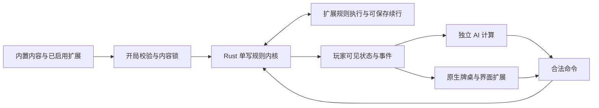

# 无名杀性能优先技术架构评估

全新重构架构决策文档

版本 3.3　原始评估日期 2026 年 9 月 15 日；扩展范围修订 2026 年 9 月 22 日；全量来源细化 2026 年 9 月 23 日；旧 JS 兼容范围与扩展后端定案 2026 年 10 月 12 日（[ADR 0782](docs/adr/0782-extension-backend-and-legacy-js-scope.md)）

本次按用户要求恢复原有扩展机制为必做能力，覆盖 v3.2 排除动态扩展的决定。源码评估依据沿用原记录，扩展实现仍待验收。本文是目标架构；实际开发状态与上游缺口以 [当前进度](docs/architecture/native-progress.md) 和 [两仓扩展台账](docs/migration/upstream-extension-reconstruction.md) 为准。原配套 DOCX 是 v3.2 旧版导出，与本版扩展范围冲突，已于 2026-10-10 删除（可从 git 历史取回）；仓库中没有 PNG 导出。

## 1 决策摘要

以研发与维护成本不设上限为前提，采用全新 Rust 原生规则内核、数据与显示分离、可暂停的顺序事件执行器、独立 AI 计算池，以及面向平台调优的原生 GPU 牌桌。内置官方内容随程序预编译；第三方扩展可独立分发、安装与装载，开局前固定本局内容集合与版本。桌面与移动端作为性能基准，浏览器端作为独立部署目标，不约束原生端的性能设计。

### 全新实现范围

保留原有扩展机制：玩家能安装、启停、更新、卸载扩展；作者能扩展武将、技能、卡牌、模式、规则、资源、配置、AI 与界面。规则扩展必须能在不重新编译整套客户端的情况下发布。旧扩展按能力清点并适配，不能将“非内容扩展”整体排除。现有 JS 扩展不承诺零改动运行（2026-10-12 用户决定 D2，[ADR 0782](docs/adr/0782-extension-backend-and-legacy-js-scope.md)）：旧扩展按能力重构，第三方扩展经新 SDK（包数据 + rule-vm 规则字节码）发布。

**2026-09-23 范围细化：**用户指定 `archive/upstream/noname` 与 `archive/upstream/noname-liuli` 下全部扩展重构支持。当前分别 8、29 个目录，共 37 个来源实例；含子包、插件、模式、规则、AI、UI、配置、工具与资源及其运行所需依赖。同名扩展保留来源差异，不以“非内容”排除；按新接口重构保留功能；旧 JS 零改动运行已于 2026-10-12 决定不承诺（D2）。逐项方案、宿主改造与 G0–G5 门槛见 [全量扩展重构计划](docs/migration/upstream-extension-reconstruction.md)。这是必做范围，尚未交付。

新内核仍采用独立数据模型。旧客户端、旧存档录像、旧联机协议与旧配置文件格式的自动兼容不因本次要求而默认纳入；扩展自身的配置与持久化能力需要保留。已有玩法与官方技能规则作为重建参考，已确认的旧实现缺陷不必复现。详见 [原生扩展机制](docs/architecture/native-extensions.md)。

主要优化点是减少重复查询、动态对象访问、跨运行时调用和显示等待。Rust 与 C++ 均可实现，本报告选择 Rust；语言本身没有已验证的性能领先。

### 本次重新评估的修正

- 现有项目已经有技能编译缓存、选择缓存和触发索引。改造重点是这些机制的数据依赖与执行边界，而不是重新添加同名机制。
- 内置技能使用类型化 Rust API 与必要的构建期代码生成；可独立发布的逻辑扩展通过版本化宿主接口接入。扩展执行后端依据旧扩展兼容要求、可恢复性与同负载原型确定，撤销一概排除脚本/模块运行时的限制；2026-10-12 定案为内置 HostBehavior + 扩展包 rule-vm（ADR 0782）。
- 官方技能可以预编译，但技能获得、失去、临时失效、目标改写等仍是运行时行为，不能把整局触发图静态固化。
- 单局规则默认串行，AI 分支与多局模拟并行。渲染和计算隔离，但线程数量、快照格式与 GPU 后端由真实负载决定。
- 原生 GPU 提供更直接的优化空间。wgpu 可作为通用后端；如果追求特定平台的最终上限，应允许 Metal、Vulkan、D3D12 专用实现参与同场景对比。

### 性能目标的解释

本报告将“最大化性能”解释为：保持规则结果、可见内容和交互语义正确，在固定目标设备上优先降低交互尾延迟、规则执行耗时和 AI 决策耗时，同时控制长局内存与持续发热。吞吐量模式可以消耗更多 CPU，交互模式须给画面和输入保留资源。

复杂实现须在相同工作负载下证明收益；成本不设上限仍受串行依赖、缓存、带宽和功耗约束。

### 证据边界

源码基准为 1f33036afb0f4232db05c0ba08929940af31bbd7（2026-09-15 10:30，UTC+8）。17 个关键文件均核对 Git blob 哈希。本文交付架构决策与验收口径；具体重构明细交由后续模型细化。未完成全量实现或原版性能对比，不宣称已达到性能上限。来源见第 13 节。

<!-- PAGE -->

## 2 源码证据与性能假设

### 数据对象与显示对象共同承担规则状态

Player 继承 HTMLDivElement，创建手牌、装备和标记节点，同时保存技能、血量、行动历史等状态。AI 的 chooseCard 和 chooseTarget 会修改 selected 样式与 ui.selected，然后调用 game.check。选择检查继续读写 DOM 类名。这说明规则与界面之间存在真实依赖，阻碍无界面模拟和直接迁移到后台线程。[S01][S02][S03]

推论：脱离 DOM 的规则内核是结构性改造点。尚不能据此断定 DOM 占据当前总耗时的最大比例。

### 已有缓存需要测量命中率与构造代价

ContentCompiler 用 WeakMap 保存编译结果，StepCompiler 将旧式步骤内容拆开构造函数；AsyncCompiler 将异步内容接入现有执行链。因此，不能把每次技能执行都描述为重新解析全部源码。[S04][S05][S06]

CacheContext 支持代理与缓存注入，构造缓存键时可能递归遍历参数，对函数参数还会计算源码字符串的 MD5。是否值得替换，要统计调用次数、命中率、参数规模和构键耗时。[S07]

### 事件索引与动态结算顺序已经存在

GameEvent 使用 hookmap 及按玩家、角色和事件名组织的 hook，处理临时技能，并按优先级和座次安排执行。事件保存父子关系，运行时写入全局历史。新内核必须保留这些语义，同时避免无必要的对象保留与重复排序。[S08][S13]

### 布局与启动路径存在可验证的改造候选

ui.updatehl 在更新卡牌 transform 的路径中调用 refresh，并读取部分布局宽度；refresh 会读取计算样式。该模式有样式或布局同步风险，是否发生强制布局及实际耗时需要轨迹验证。[S09]

初始化遍历 config.all.cards 与 config.all.characters 导入包，并等待加载任务。应分别测量模块读取、解析和注册时间，而不能把资源包大小等同于全部图片已解码。[S10]

### 两个容易混淆的模块

packages/jit 中包含 TypeScript 与 Vue 单文件组件的编译策略。它不是 Rust/WASM 规则执行器，也不是已经测得的技能计算热点；生产路径是否触发要单独记录。[S11]

当前 WebSocket 服务包含房间管理和从参与者向房主转发消息的逻辑。权威服务器是新增部署能力，会改变计算位置与网络等待，不能直接算作客户端延迟收益。[S12]

<!-- PAGE -->

## 3 技术选型与替代方案

| 决策领域 | 主选型 | 选择依据与限制 |
| --- | --- | --- |
| 规则与状态 | Rust 原生库 | 紧凑数据与显式生命周期；C++ 是同级替代 |
| 官方技能 | Rust API 与构建期生成 | 技能目录构建时固定，实例的获得与失去仍动态处理 |
| 事件执行 | 显式栈与可暂停状态机 | 只在需要输入或外部结果时挂起 |
| AI | 原生评估与有界计算池 | 分支和样本并行；小任务允许直接执行 |
| 牌桌 | 原生保留式 2D UI | 缓存布局和文字，控制绘制与呈现时序 |
| 图形后端 | wgpu 与平台专用候选 | 同场景实测选择；API 层级不代表速度排名 |
| 平台集成 | 原生窗口与系统桥接 | 输入法、无障碍、音频、生命周期与更新 |
| 浏览器 | WASM 与 WebGPU | 独立性能档位；线程和后端能力需检测 |
| 服务器 | Rust 无界面引擎 | 每房间单写，多房间分片调度 |
| 内容发布 | 内置预编译 + 独立扩展包 | 保留安装/启停/更新/卸载；逻辑扩展通过版本化接口运行，本局冻结内容锁 |

### 为什么不把语言作为性能结论

Rust 与 C++ 在相同算法、数据布局、编译器设置下的结果可能接近，也可能因具体代码不同而变化。优先统一核心语言以减少边界复制；只有性能剖析证明某个库或内核有稳定收益时，再引入另一语言，并按批量任务设计调用接口。

发布配置应对 LTO、PGO、代码生成单元和内联策略做矩阵比较。PGO 是利用代表性运行数据指导优化；收益依赖样本覆盖。不能将开发机器的 CPU 专属指令直接当作所有设备的最低要求。[T02][T03]

### 通用引擎与 Web 技术的位置

Unity、Godot、Bevy 等通用引擎可以实现流畅牌桌，但本项目的主要需求是规则、文字、卡牌和 AI。专用引擎能更直接控制状态和执行路径；本次没有对这些产品跑同等原型，不给出未经测试的快慢排名。

新客户端的规则和牌桌不依赖 Vue、React、Electron、Tauri 或 WebView。外部内容编辑工具可以独立选择技术，不进入游戏运行路径。原生端仍须在等价画质和规则下证明性能收益。

<!-- PAGE -->

## 4 运行模型与数据流

### 对局状态只由一个执行者修改

客户端为当前对局提供逻辑执行上下文。事件按规则顺序推进，直至等待玩家输入、等待 AI 或到达让出执行权的预算。单个卡牌技能链通常具有前后依赖，不按玩家或技能强行拆成多个写线程。

服务端采用同一语义，但一个工作线程可轮转执行多个房间；“每房间单写”不等于每个房间占用一个操作系统线程。CPU 密集的 AI 任务进入独立池，避免堵住网络事件循环。

### 命令与显示结果使用不同通道

- 输入命令包含 command_id、选择请求 ID、预期状态版本和玩家动作。引擎校验后提交，重复命令不得重复执行。
- 规则状态版本单调增加。显示端接收可见状态快照或增量，并用版本检测遗漏与过期。
- 血量、位置等显示状态允许合并为最新值；音效、关键动画和日志事件需要独立序号，不能因丢弃旧快照而丢失。
- AI 任务携带局面版本、选择请求 ID 和规则版本。玩家取消操作、切局或状态变化后，过期结果须丢弃。

### 渲染与计算隔离的实现

使用有界通道和不可变的紧凑显示快照作为默认方案。状态很小时，完整复制可能比复杂差分更快；状态变大时，再选择增量或共享只读缓冲。双缓冲、三缓冲与原子引用发布都需要验证读者仍在使用的数据不会被覆盖。

显示合并可吸收暂时落后的渲染端；不可丢失的事件则需要有界积压、消费确认或从日志恢复。引擎不能等待某个动画自然播完才允许无关计算继续，但用户应看到的因果顺序必须保留。

UI 与 GPU 提交是否拆线程，由平台和帧耗时决定。默认避免一层操作经过多个小消息转发，以免同步成本超过工作本身。

<!-- PAGE -->

## 5 对局数据与事件内核

### 数据结构按访问方式组织

静态卡牌、角色和技能定义只读共享；每局只保存状态。玩家、卡牌、技能实例和事件使用稳定 ID，复用槽位时带代数，防止旧引用误指向新对象。数值类型根据规则边界选择，不提前把人数或手牌数量限制为小整数范围。

高频一起访问的字段放在紧凑结构中；对大量对象同一字段进行扫描时，才考虑按字段分列存储。玩家数量较少时，简单连续数组通常是合理基线。位集合适合固定规模集合，但需要保留顺序的牌堆与选择不能被无序位集替代。

### 事件执行与显示时间分开

逻辑使用显式事件栈，记录事件种类、父事件 ID、阶段、局部数据和返回值。同步可完成的规则连续执行；等待选择时保存续执行位置，收到合法结果后恢复。是否用枚举、函数表或编译生成的状态机，按代码体积和热点结果选择。

运行时维护有效技能集合与触发索引。优先级、座次、首次与末次触发、技能中途加入或删除都必须有确定语义。已有事件的合法改写通过类型化操作完成，不让调用方任意修改内存。

### 缓存必须绑定完整依赖

高频查询缓存优先使用整数 ID 与相关状态版本，例如手牌版本、技能版本、距离修正版本。技能若能读取全局状态或历史，必须声明依赖或采用更保守的全局版本。不能只用玩家与卡牌 ID 缓存会随局面改变的结果。

哈希用于快速定位候选项，必要时验证完整键。历史、随机数状态、事件续执行位置、临时效果与隐藏信息都可能影响合法动作；只比较表面牌面不足以复用模拟结果。

### 生命周期与确定性

事件临时内存可以使用 arena，即按阶段集中分配和释放的区域；逃逸到历史或续执行状态的数据必须单独保留。对象池只用于已证明分配频繁的类型，清理所有逻辑字段，避免复用污染。

历史查询应有明确范围和索引。允许全局历史查询的技能存在时，不能随意截断记录；可用紧凑记录与派生摘要减少空间。稳定排序、固定随机算法、显式溢出处理和规则版本是重放基础。权威规则尽量使用整数；浮点评估输出不承担跨平台规则一致性责任。

<!-- PAGE -->

## 6 全新技能执行系统

### 官方技能以原生执行为目标

提供全新类型化接口：查询只读局面、申请选择、移动卡牌、修改状态、发出领域事件。技能通过 Rust 函数、枚举和必要的宏编写，构建时生成触发元数据与分发表；内置路径不模拟旧 player、game、get 或 _status 接口，旧扩展所需适配由扩展兼容边界单独定义。暂停点的局部状态必须可检查和可保存。

只有当重复规则形态足够稳定时，才引入领域描述或中间表示。它的价值在于验证依赖、生成代码和管理续执行位置，不应让每个原本简单的操作都增加一层解释器。无法准确表达的技能通过经过审查的原生接口实现。

### 预编译也有性能代价

将大量技能全部内联进大函数，会增加机器码和指令缓存压力。应按模式或内容集组织代码，保持热代码紧凑，保留低频间接调用。完整构建、按包构建和冷热分离需要对启动、代码页驻留与模拟吞吐做联合比较。

原生编译收益必须与现有运行时充分预热后的结果比较，不能只比较 JS 首次编译和原生热态执行。[S04][S05]

### 内置内容与扩展执行路径

| 内容 | 表达方式 | 运行方式 |
| --- | --- | --- |
| 内置技能定义 | 类型化 Rust 代码与构建期元数据 | 与规则内核共同编译 |
| 扩展规则定义 | 独立扩展包与版本化宿主接口 | 开局前校验/装载，运行期经同一规则执行器调用 |
| 扩展界面/配置 | 受支持的显示、交互与配置接口 | 消费可见状态，用户动作提交合法命令 |
| 玩家技能状态 | 固定技能 ID 与独立实例状态 | 获得、失去和临时失效由规则更新 |
| 美术与音频 | 版本化资源包 | 后台加载并按预算驻留 |

内置技能保留原生执行路径；独立扩展需要单独验证装载与执行方案，不能用“与客户端一起重编译”替代动态扩展能力。后端已按真实扩展对照原型定案（2026-10-12，[ADR 0782](docs/adr/0782-extension-backend-and-legacy-js-scope.md)）：扩展包规则用 rule-vm，WASM 暂缓，不引入 JS 运行时，也不直接复制旧 VM；原型已验证功能、暂停/恢复、资源限制和调用开销，引擎接线另行验收。浏览器整套引擎的 WASM 部署与扩展模块执行是不同问题。

### 本局固定目录与动态玩法

内置定义在构建时生成元数据；扩展定义在开局前按依赖解析、校验并合并为不可变目录。以命名空间、包版本和定义键分配本局稳定 ID，内容锁相同的对局可共享目录；不能把目录全局固定为唯一内置集合。运行时仍处理技能获得、失去、目标改写和临时效果。

内置技能实例保存类型化数据；扩展状态与挂起点必须有受校验、可版本化的编码，并进入快照、哈希和回放。扩展安装/升级可独立于客户端发布，生效于下一局；进行中的对局仍绑定原内容锁，更新、禁用或卸载不能让其丢失必需代码和资源。

### 新模块边界

规则库拥有状态、命令和事件；内容模块提供内置定义；扩展管理负责包生命周期、依赖和内容锁；扩展执行侧通过版本化规则接口查询与提交效果，不绕开顺序事件与事务。AI/显示扩展只读取所属座位的合法视图；平台模块提供资源和交互接口。旧接口适配以确认的兼容范围为准。

最低能力、可复用旧实现、实施顺序和验收清单见 [原生扩展机制](docs/architecture/native-extensions.md)。扩展规则执行、包管理与保存恢复属于本仓库必做；具体原生 UI/平台接入仍按已有另轨安排交付，接口和能力要求不得删除。

<!-- PAGE -->

## 7 AI 与批量模拟

### 将决策能力与运行速度分开评价

当前基础 AI 以候选评分和选择为核心，并依赖 UI 选中状态。第一阶段实现相同输入信息、相同候选空间和相同评分语义的原生决策器，才能公平衡量引擎收益。更强搜索算法属于另一条质量改进曲线。[S02]

合法动作生成、评分和状态推进必须能在无显示环境运行。AI 只获得规则允许的信息视图；模拟对未知手牌和身份的假设需要显式标记，不能无意读取服务器完整状态。

### 并行任务应有足够工作量

候选动作、隐藏信息样本和多局模拟可作为独立任务。使用有界线程池，根据任务规模选择串行或分批并行。Rayon 可以承担这类数据并行工作；不把网络异步运行时当作无限 CPU 任务池。[T04]

每个工作任务拥有独立可变状态，只共享只读定义。先比较三种模拟方式：紧凑状态复制、执行与撤销、分块写时复制。无名杀状态未必很大，完整复制可能最简单也最快；撤销机制则必须覆盖技能状态、事件栈、历史和随机数。

### 保持搜索预算与结果可复核

- 交互模式使用时限，及时返回当前最佳合法结果；取消任务时，工作单元在合理检查点停止。
- 基准模式固定节点或模拟次数，固定随机种子与结果合并顺序，避免机器速度改变搜索量。
- AI 结果附局面版本，状态变化后不提交过期动作。
- 置换表按完整规则状态与信息集设计键，并明确碰撞处理，不能只按可见牌面共享结果。

### SIMD 与 GPU 的适用范围

SIMD 适合批量特征评估等同形计算，须考虑小批量准备数据的成本。GPU 适合足够规模的模型推理或结构一致的批量任务；分支密集、频繁触发技能的单局结算默认留在 CPU。

评估 GPU 时计入数据准备、上传、同步、下载和启动开销，并检查与画面渲染争用 GPU 后的帧尾延迟。单次请求延迟和批量吞吐可能选择不同后端。

### 模拟程序与客户端共享规则

无界面模拟程序只链接规则、技能和必要的数据加载代码，关闭显示、音频和不参与规则的展示日志。规则历史仍须保留。每秒模拟局数必须附带牌包、模式、终止条件与平均事件数，不能拿缩减规则的速度代表完整游戏。

<!-- PAGE -->

## 8 原生界面与 GPU 渲染

### 采用面向牌桌的保留式显示结构

显示树保留卡牌、头像、文字、标记和面板的布局结果，只在数据、字体、尺寸或缩放变化时重新计算。动画更新位置与透明度，通常不重新排版文本。卡牌操作命中检测与视觉层级一致，输入法和无障碍通过平台接口提供。

原生绘制移除了浏览器 DOM 样式机制，但不会自动消除文字塑形、裁剪、布局或合成工作。需要在等价字体、清晰度、动画和效果下比较，不能通过降低画质制造性能收益。

### 批量绘制必须保留视觉顺序

卡牌和头像采用图集或纹理数组，按相同绘制条件批量提交。透明卡牌存在前后顺序约束，不能为了减少 draw call 任意排序。裁剪、滤镜与离屏效果要单独统计，优先控制过度绘制和中间纹理分配。

中文文字使用可靠的塑形与字体回退机制，缓存字形、排版结果和样式。不同缩放与描边不能无界扩张缓存。高分屏图片按显示尺寸选择资源，避免每张小头像长期驻留超大纹理。

### 平台后端是可测量的候选

wgpu 覆盖原生 Metal、Vulkan、D3D12 等及浏览器路径，可以作为通用实现。[T01] 最高性能目标下，应为热点平台保留直接调用原生图形 API 的候选实现，比较 CPU 提交时间、GPU 时间、呈现延迟与功耗后确定正式后端。

不预设“原生 API 必定胜过 wgpu”，也不预设多线程提交更快。小规模 2D 场景可能主要受纹理带宽、文字或系统合成限制。

### 帧节奏比平均帧率更接近体验

在呈现前及时采样输入，控制在途帧数量，避免 GPU 队列积压增加延迟。平台提供的垂直同步与帧节奏能力应纳入实现；Android 的 Frame Pacing 文档明确讨论了队列积压、帧间隔和输入延迟问题。[T05]

动画运行时匹配目标刷新率；静态页面按需重绘。移动端将稳定帧节奏、温控后性能和交互响应作为组合指标，不能用短时间峰值 FPS 代替持续表现。

显示快照允许合并，但“出牌、造成伤害、播放提示”等具有因果关系的表现事件应按序处理。跳过动画模式可以加速展示，规则结果必须与正常模式一致。

<!-- PAGE -->

## 9 资源加载与多端部署

### 构建期完成可提前处理的工作

生成资源索引、尺寸信息、依赖关系和内容哈希，按启动界面、模式与角色组织资源。图片尺寸、纹理格式和音频策略按设备能力生成不同产物。包内资源可随机读取，避免使用需要解压整个大包才能访问一项的组织方式。

GPU 压缩格式按明确支持的硬件档位生成。压缩体积小不意味着解码快，也不意味着显存占用低。纹理转码应在后台执行，并计入首次显示耗时。

### 按关键路径加载

首屏只等待必要字体、布局、设置和最小资源。角色目录使用轻量元数据，选择模式与牌包后加载其依赖；对会动态引用其它技能的内容，应包含依赖闭包或安全的后台加载机制。不能因“按需加载”让合法技能在结算中缺失。

后台读取、解码与 GPU 上传分开限流。资源完成时带请求代数，切换模式或关闭界面后不把旧请求重新挂回显示树。纹理、音频和 CPU 解码缓存分别设置预算，记录峰值与回收时机。

### 原生应用形态

| 平台 | 核心执行 | 平台职责 |
| --- | --- | --- |
| Windows | Rust 原生 | 窗口、输入法、D3D12 或通用后端 |
| macOS | Rust 原生 | 系统窗口与输入、Metal、显示同步 |
| Linux | Rust 原生 | 窗口系统、输入、Vulkan |
| Android | Rust 原生 | Activity 生命周期、输入、音频、帧节奏 |
| iOS | Rust 原生 | 应用生命周期、输入、音频、Metal |
| 浏览器 | WASM | Worker 与 WebGPU |

平台窗口和服务可使用成熟库，并允许针对目标设备替换热点。各端明确最低系统、GPU 与线程能力；达不到要求的设备不进入本版本支持范围。新增技能通过经过验证的新构建发布，资源可以独立更新，但必须匹配规则版本。

### 浏览器保留独立性能档位

规则内核编译为 WASM，后台线程使用纯数据接口。Worker 不可直接访问 DOM，普通消息也可能发生复制。[T06] SharedArrayBuffer 等共享内存能力受安全上下文与跨源隔离条件约束；浏览器部署应满足这些条件，不满足时明确提示能力不足；不为旧环境强制降低原生实现上限。[T07]

浏览器的 GPU、线程、内存与调度能力通过启动时检测选择。桌面原生端的基准结论不直接推广到浏览器，所有跨端规则结果则应保持一致。

<!-- PAGE -->

## 10 联机与持久化

### 规则服务与网络层分开

权威服务器运行同一个无界面规则内核，按房间分区执行。网络层负责认证后的消息收发、流量限制与连接管理；规则执行和 AI 计算不长时间占用网络任务。优先按房间分片扩展容量，避免单局状态跨机器频繁同步。

单机模式直接本地执行，不为统一结构强制走远程调用。联机权威化主要改善一致性、状态控制和重连能力，可能增加一个网络往返，并非无条件降低操作延迟。[S12]

### 协议按状态变更组织

命令携带玩家、命令序号、选择请求 ID、状态版本和动作参数；服务端重新验证合法性。输出包含新的状态版本、玩家可见增量和表现事件。小消息先保持清晰的结构，只有序列化或带宽占比明显时，才选择紧凑二进制编码。

可靠顺序传输是回合制动作的默认要求。WebSocket 是可用基线；原生传输是否改为 QUIC 等方案，需要在目标 RTT、丢包、重连与代理环境下验证。协议名称不能消除物理网络时延。

### 隐藏信息和重连

每个客户端只接收其可见的手牌、身份和事件详情。客户端可以先显示按下、拖动等本地反馈；最终结算以服务端确认状态为准。不得为方便客户端模拟而广播完整隐藏局面。

重连提供可见快照及后续事件序号；客户端发现版本断档后重新取快照。重复提交通过命令 ID 去重。房间固定引擎/API 版本、扩展包版本/逻辑哈希、依赖和影响规则的配置。客户端入房校验内容锁，不一致时阻止开始并提示缺失或冲突；不在对局中途隐式更换技能实现。

### 保存和恢复的粒度

权威状态、随机数状态和必要续执行信息在可恢复的逻辑边界保存。局部操作缓冲或事务保证失败时不留下半个技能的状态。命令日志与定期快照用于恢复和问题复现，内存状态仍是实时执行的数据源。

磁盘和数据库写入批量处理并独立于渲染线程。若产品要求“确认成功即使断电也不丢失”，必须在回复前完成对应持久化，延迟预算中计入这部分成本；如果允许短窗口丢失，也要明确窗口而非宣称无损。

### 版本迁移与跨端一致性

新存档包含模式、规则包、引擎版本、数据格式版本，以及本局扩展内容锁、扩展状态和挂起续行数据。缺少匹配扩展或版本不兼容时明确拒绝恢复；安装所需版本后应可继续，不能静默省略扩展效果。新录像依赖明确匹配的规则版本；旧项目的存档、录像与配置不导入。新版本之间的长期保留策略另行定义，当前不实现自动迁移。Windows、macOS、Linux、移动端与 WASM 用相同命令和随机种子验证状态摘要，发现差异时定位到首个不同事件。

<!-- PAGE -->

## 11 性能验证与验收标准

### 先定义公平的比较条件

原版固定到本报告提交作为性能参考；比较相同模式、技能集合、随机牌序、用户动作、画质、字体、分辨率与动画策略。输入通过各自接口驱动，不要求协议、事件对象或存档格式相同。AI 同时报告相同评分语义的速度和相同质量目标的速度。任何规则缺失或隐藏信息泄露都判定为无效性能结果。

下表是建议验收口径与初始预算，不是已测成绩。设备具体型号、操作系统、功耗模式和温度条件须在执行前固定。

| 指标 | 建议口径与初始门槛 |
| --- | --- |
| 桌面动画 | 120 Hz 档位，P99 应用帧间隔不超过 8.33 ms 为目标 |
| 移动端动画 | 60 Hz 档位，P99 应用帧间隔不超过 16.67 ms 为目标 |
| 本地输入响应 | 从系统收到输入到对应帧提交，P95 不超过 1 个刷新周期为目标 |
| 规则执行 | 排除人为动画与网络等待，报告 P50 P95 P99 及每秒事件数 |
| AI | 固定节点数与信息条件，报告延迟、节点吞吐和结果质量 |
| 冷启动 | 进程创建到可操作，记录首次安装与稳定安装后的独立样本 |
| 长局内存 | 报告状态、历史、资源、显存和峰值，重复同场景后无异常累积 |
| 持续负载 | 至少 30 分钟，报告温度条件、降频、耗电与帧节奏 |
| 联机 | 明确 RTT 与丢包档位，分离服务端处理和网络等待 |
| 扩展 | 分别测未启用/启用真实扩展的启动、触发、选择/恢复、AI 与长局资源；等价功能和内容锁下比较 |

应用帧提交不等于像素已经显示。显示端到端延迟需要呈现时间戳或外部测量，不能用 CPU 函数耗时代替；系统合成导致的超时样本应保留并解释。

### 覆盖真实场景与机制压力

代表场景包括标准身份局、多人复杂技能连锁、大量手牌与目标选择、频繁获得或移除技能、长局历史查询、角色目录浏览，以及断线重连。构造的极端压力场景单独标记，不冒充常见体验。

### 对照实验与发布约束

分别比较数据布局、缓存策略、状态复制方式、线程数、原生与脚本技能、图形后端、PGO 和资源预加载；每次保持其它条件一致。微基准用于解释热点，端到端对局用于判断收益。

建议热态微基准至少重复 30 组、冷启动至少 20 次，保留原始数据并报告分布和不确定性；样本不足时追加。所有优化必须通过规则一致性和显示等价检查。没有测量前不填写倍数提升或宣称某语言、API、线程方案绝对最快。

<!-- PAGE -->

## 12 实施顺序与关键决策

### 第一阶段 固定规则语义与基线

为新项目定义事件轨迹、选择请求、随机结果和状态摘要。先覆盖伤害响应、目标转移、取消事件、技能中途变化、嵌套选择与历史查询。预期玩法规则是正确性的依据，原系统用于帮助理解行为；确认的旧实现缺陷不复现。

交付物是新规则规范、可重放场景、原版性能参考和明确的行为差异清单。对比的是玩法效果与计算量，不建立旧数据迁移器。

### 第二阶段 验证原生核心

建立无 DOM 的状态与事件执行器，迁移一组代表性官方技能。对比同样的规则轨迹，并验证状态保存、续执行、随机性和撤销。先实现数据结构与同步执行基线，再比较更复杂的内存与分发方案。

交付物是可独立运行的规则库、无界面模拟器和同负载性能数据；同时定义扩展宿主接口，并跑通一个无需重编译客户端的规则扩展及其选择/存档恢复。只有语义通过后才扩大内容覆盖。

### 第三阶段 验证渲染与 AI 上限

用等价素材和布局建立原生牌桌，比较 wgpu 与重点平台原生后端。并行开展 AI 基线移植与任务粒度实验；不得在速度对比中混入更强算法或不同候选空间。

交付物是帧节奏、输入延迟、AI 吞吐和温控曲线。根据结果确定线程布局、快照方式与正式图形后端。

### 第四阶段 完整内容与平台收敛

按新规则规范逐模式重建官方内容，完善扩展 SDK、独立发布、启停/更新/卸载、依赖冲突、联机内容锁和扩展存档续跑。按旧扩展清点表交付规则、模式、AI、配置与表现扩展的能力适配；旧 JS 不承诺零改动运行（D2，2026-10-12）。补齐原生牌桌、移动端、浏览器、权威服务端和资源更新；旧客户端与旧存档格式本身仍不在默认兼容范围。

### 必须通过实验确定的决策

| 决策 | 默认起点 | 替换条件 |
| --- | --- | --- |
| 语言 | Rust | 等价热点实现证明替代库有稳定端到端收益 |
| 状态布局 | 紧凑结构与数组 | 扫描热点证明字段分列或位集更有效 |
| 模拟状态 | 完整复制 | 撤销或写时复制在同语义下更快 |
| 线程 | 单写逻辑与有界 AI 池 | 新划分改善尾延迟且不增同步瓶颈 |
| 技能表达 | 内置类型化 API 与必要代码生成 | 稳定重复规则证明编译表示有收益 |
| 扩展执行 | 先验证独立规则包与版本化宿主接口 | 以兼容需求、恢复/隔离正确性、跨端能力和实测开销选择后端（2026-10-12 选定 rule-vm，ADR 0782） |
| 图形后端 | 通用与原生候选对照 | 目标设备数据决定最终实现 |

最终建议保持不变的是数据、规则、显示和计算任务的边界；需要调整的是具体语言库、数据布局和调度参数。成本不设上限时，应投入充分的等价原型和设备实验，让测量结果决定最终技术组合。

<!-- PAGE -->

## 13 源码与技术资料

### 固定提交的源码证据

以下源码链接固定在提交 1f33036afb0f4232db05c0ba08929940af31bbd7。行号对应本次下载并核对哈希后的内容；引用支持结构事实，不代表性能剖析结果。

- [S01 玩家对象与 DOM 继承 第 9 行起](https://github.com/libnoname/noname/blob/1f33036afb0f4232db05c0ba08929940af31bbd7/apps/core/noname/library/element/player.js#L9)　玩家节点、状态与行动历史共同存放。
- [S02 AI 选择逻辑 第 77 行起](https://github.com/libnoname/noname/blob/1f33036afb0f4232db05c0ba08929940af31bbd7/apps/core/noname/ai/basic.js#L77)　候选评分、缓存作用域、选中状态与 game.check 调用。
- [S03 选择检查 第 4 行起](https://github.com/libnoname/noname/blob/1f33036afb0f4232db05c0ba08929940af31bbd7/apps/core/noname/game/check.js#L4)　选择缓存及 DOM 类名读写。
- [S04 ContentCompiler 第 67 行起](https://github.com/libnoname/noname/blob/1f33036afb0f4232db05c0ba08929940af31bbd7/apps/core/noname/library/element/GameEvent/compilers/ContentCompiler.ts#L67)　WeakMap 编译缓存及编译器分发。
- [S05 StepCompiler 第 69 行起](https://github.com/libnoname/noname/blob/1f33036afb0f4232db05c0ba08929940af31bbd7/apps/core/noname/library/element/GameEvent/compilers/StepCompiler.ts#L69)　旧式步骤解析与函数构造。
- [S06 AsyncCompiler 第 16 行起](https://github.com/libnoname/noname/blob/1f33036afb0f4232db05c0ba08929940af31bbd7/apps/core/noname/library/element/GameEvent/compilers/AsyncCompiler.ts#L16)　异步内容接入现有编译链。
- [S07 CacheContext 第 176 行起](https://github.com/libnoname/noname/blob/1f33036afb0f4232db05c0ba08929940af31bbd7/apps/core/noname/library/cache/cacheContext.js#L176)　缓存查询与参数键构造。
- [S08 GameEvent 第 226 行起](https://github.com/libnoname/noname/blob/1f33036afb0f4232db05c0ba08929940af31bbd7/apps/core/noname/library/element/gameEvent.ts#L226)　执行和历史；第 487 至 625 行附近为触发索引、排序与临时技能处理。
- [S09 UI 更新 第 434 行起](https://github.com/libnoname/noname/blob/1f33036afb0f4232db05c0ba08929940af31bbd7/apps/core/noname/ui/index.js#L434)　手牌布局；第 220 行附近为计算样式读取。
- [S10 初始化 第 339 行起](https://github.com/libnoname/noname/blob/1f33036afb0f4232db05c0ba08929940af31bbd7/apps/core/noname/init/index.ts#L339)　遍历配置的牌包与角色包并等待导入。
- [S11 JIT 编译策略](https://github.com/libnoname/noname/blob/1f33036afb0f4232db05c0ba08929940af31bbd7/packages/jit/src/service-worker/compile-strategy.ts)　TypeScript 与 Vue 编译支持。
- [S12 WebSocket 服务 第 330 行起](https://github.com/libnoname/noname/blob/1f33036afb0f4232db05c0ba08929940af31bbd7/packages/server/src/server/createServer.ts#L330)　房间消息接收与转发。
- [S13 标准技能包](https://github.com/libnoname/noname/blob/1f33036afb0f4232db05c0ba08929940af31bbd7/apps/core/character/standard/skill.js)　动态技能逻辑、选择与事件目标改写的实例。

另外核对了核心、Electron、移动端的 package.json 和 JIT service worker 入口，共 17 个文件。旧架构资料用于分析改造机会，不构成兼容义务。此次没有统计完整仓库的技能总量，也没有以源码行数估算运行性能。

<!-- PAGE -->

### 官方技术资料

下列资料于 2026 年 9 月 15 日查阅。它们用于确认 API 能力与实现边界，不提供本项目性能排名。

- [T01 wgpu 官方介绍](https://wgpu.rs/)　原生和浏览器图形后端覆盖。
- [T02 Rust PGO 文档](https://doc.rust-lang.org/rustc/profile-guided-optimization.html)　基于运行数据的编译优化流程。
- [T03 Cargo 构建配置](https://doc.rust-lang.org/cargo/reference/profiles.html)　LTO、优化等级和代码生成配置。
- [T04 Rayon 官方文档](https://docs.rs/rayon/latest/rayon/)　数据并行和线程池接口。
- [T05 Android Frame Pacing](https://developer.android.com/games/sdk/frame-pacing)　帧节奏、队列积压、呈现和延迟。
- [T06 MDN Web Workers](https://developer.mozilla.org/en-US/docs/Web/API/Web_Workers_API/Using_web_workers)　线程环境、DOM 边界和消息传递。
- [T07 MDN SharedArrayBuffer](https://developer.mozilla.org/en-US/docs/Web/JavaScript/Reference/Global_Objects/SharedArrayBuffer)　共享内存和跨源隔离要求。

### 文档交付边界

第 1 至 3 节用于选型决策，第 4 至 10 节定义架构边界，第 11 节定义性能验收方式，第 12 节提供验证顺序。本文仅交付架构设计。模块内的具体接口、代码目录、逐项重构任务、实现顺序和内容覆盖清单，交由后续模型单独细化。

### 后续模型需要遵循的前提

- 研发、维护和基础设施成本不作为主要约束；优先优化目标设备上的交互尾延迟、规则执行和 AI 计算效率。
- 采用全新工程与数据模型，同时保留原有扩展机制与独立发布能力。旧扩展按能力适配；旧 JS 不承诺零改动运行（2026-10-12 D2），但不得再次以“不支持动态扩展”关闭工作。旧客户端、旧存档录像和旧协议的自动兼容仍不默认纳入。
- 玩法规则与预期体验仍须明确。无需兼容旧实现，不等于可以通过减少技能、隐藏信息泄露或降低画质来宣称性能提升。
- 以 Rust 原生规则、单写事件执行、独立 AI 计算和原生 GPU 牌桌为设计起点。平台后端、数据布局、任务粒度和编译优化由同负载实验确定。
- 后续模型须给出可审查的规则覆盖清单、模块契约、实施计划与验收证据。已有试验代码仅可作为探索参考，不视为正式重构基线或完成证明。

### 本文不构成的结论

未测量的速度提升、最终帧率、全部目标技能的规则正确性和跨端一致性均不视为已达成。任何具体技术组合是否接近性能上限，仍须通过代表性完整场景及目标设备验证。
